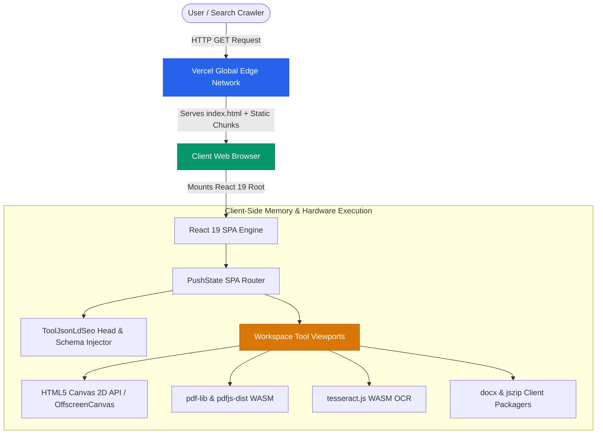
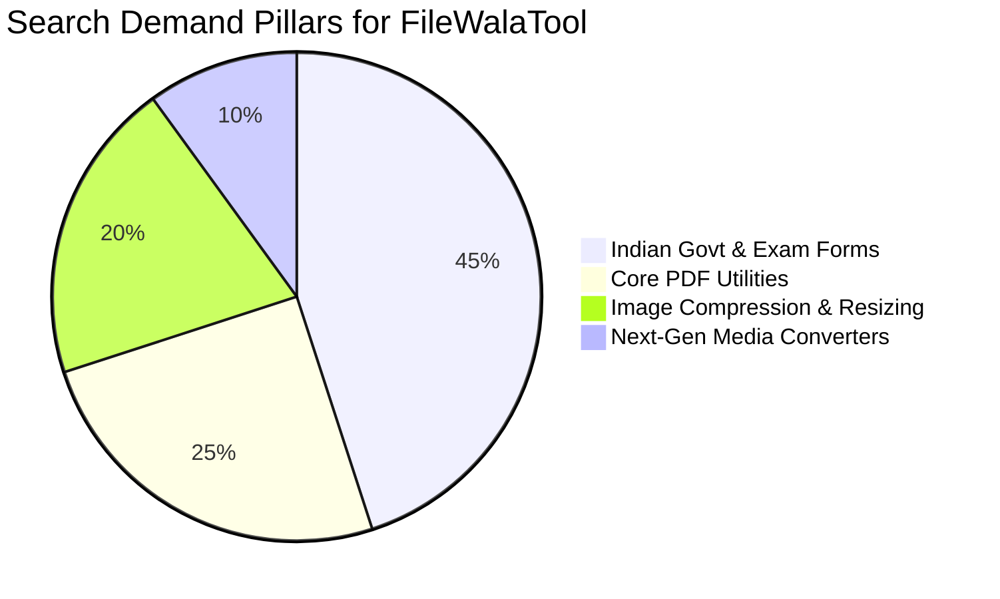
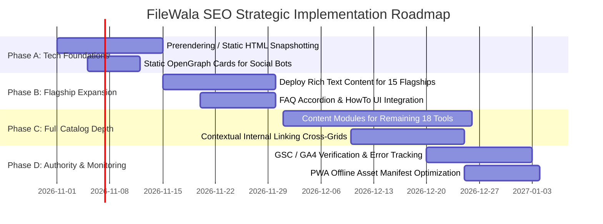

# FILEWALATOOL.COM — COMPREHENSIVE LOCAL CODEBASE SEO AUDIT, TECHNICAL ANALYSIS & STRATEGY MASTER REPORT

> **Document Type:** Technical SEO Audit & Search Architecture Strategy  
> **Target Production Domain:** `https://www.filewalatool.com`  
> **Git Repository:** `https://github.com/mdsufidev/filewalatoolv2`  
> **Audited Workspace:** Local Codebase (`d:\My All Projects\filewalatool`)  
> **Date of Audit:** October 25, 2026  
> **Auditor Role:** Senior Technical SEO Consultant, Frontend Architect & Performance Analyst  
> **Audience:** Worldwide English-speaking users, with high-affinity geographic specialization in Indian Government, Academic & Professional Document Compliance.  
> **Scope Boundary:** Research, audit, and strategic architecture. Zero application code, layouts, UI components, or design tokens modified during this audit phase.

---

## TABLE OF CONTENTS

1. [Executive Summary](#1-executive-summary)
2. [Actual Project Architecture & Technical Stack](#2-actual-project-architecture--technical-stack)
3. [Complete Page and Tool Inventory (45 Crawlable URLs)](#3-complete-page-and-tool-inventory-45-crawlable-urls)
4. [Technical SEO Findings](#4-technical-seo-findings)
   - 4.1 Indexing & Crawling Infrastructure
   - 4.2 Rendering Architecture & The Client-Side JavaScript Dependency
   - 4.3 Structured Data & Schema.org Implementation
   - 4.4 URL Structure, Canonicals & Trailing Slash Hygiene
5. [On-Page SEO Findings](#5-on-page-seo-findings)
   - 5.1 Search Intent Satisfaction Above vs. Below the Fold
   - 5.2 Heading Hierarchy & Information Architecture
   - 5.3 Thin Content vs. Utility Value Analysis
6. [Performance & Core Web Vitals Observations](#6-performance--core-web-vitals-observations)
   - 6.1 Bundle Splitting & Code Separation Results
   - 6.2 Asset Compression & Next-Gen Formats
   - 6.3 In-Browser Computation & Execution Latency
7. [Keyword Research & Search Intent Framework](#7-keyword-research--search-intent-framework)
   - 7.1 Keyword Pillar 1: Indian Government & Exam Presets (Niche Monopoly)
   - 7.2 Keyword Pillar 2: Core PDF & Image Utilities (High Global Volume)
   - 7.3 Keyword Pillar 3: Next-Gen Media Format Conversion
   - 7.4 Search Data Limitations & Hypotheses
8. [Individual Tool-Page Content Briefs](#8-individual-tool-page-content-briefs)
   - 8.1 Indian Government & Exam Compliance Suite
   - 8.2 PDF Document Suite
   - 8.3 Core Image Editing & Optimization Suite
   - 8.4 Media Format Conversion Suite
9. [Site-Wide SEO Recommendations & Information Architecture](#9-site-wide-seo-recommendations--information-architecture)
   - 9.1 Overcoming the CSR Indexing Barrier (Prerendering Blueprint)
   - 9.2 Zero-Upload Client-Side Processing as the Primary E-E-A-T Differentiator
   - 9.3 Semantic Siloing & Internal Linking Matrix
10. [Prioritized Implementation Roadmap (Phases A, B, C, D)](#10-prioritized-implementation-roadmap-phases-a-b-c-d)
11. [Testing, Monitoring & Measurement Framework](#11-testing-monitoring--measurement-framework)
12. [Unverified Assumptions & Missing Data Registry](#12-unverified-assumptions--missing-data-registry)
13. [UI/UX Preservation & Design Integrity Checklist](#13-uiux-preservation--design-integrity-checklist)

---

## 1. EXECUTIVE SUMMARY

FileWalaTool (`https://www.filewalatool.com`) is a high-utility, privacy-first web application designed to perform heavy image optimization, PDF manipulation, format conversions, and government exam document formatting **100% inside the client web browser**. 

### 1.1 The Unique Value Proposition (The "Moat")
Unlike legacy competitors (such as Smallpdf, iLovePDF, Pi7, FormPhotoEditor, and 11zon) that transmit user files to cloud storage buckets or backend processing servers, FileWalaTool processes all raster graphics, vector files, and PDF binary streams directly in browser memory using HTML5 Canvas 2D, WebAssembly (WASM), and Web Workers.
- **Zero Server Uploads:** Complete user privacy; no personal ID cards, PAN numbers, or signature scans ever leave the user's device.
- **Zero Upload Wait Time:** No upload bandwidth bottleneck; processing is immediate regardless of network speed.
- **Infinite Scalability at Zero Server Cost:** Hosting bandwidth and compute costs remain near zero on Vercel Edge networks.

### 1.2 The SEO Dilemma
While FileWalaTool possesses superior speed, privacy, and UX execution compared to competitors, its organic search discovery faces several critical technical hurdles:
1. **Client-Side Rendering (CSR) Indexing Latency:** The application is built as a single-page application (SPA) with React 19 and Vite. The initial HTML payload returned by Vercel contains an empty `<div id="root"></div>`. While Googlebot's Web Rendering Service (WRS) can render JavaScript, it operates on a two-wave indexing queue that delays discovery, title extraction, and indexing compared to server-rendered competitors.
2. **Content Asymmetry:** The application has a rich interactive UI that immediately serves users who arrive on the page, but 18 of the 33 standalone tool routes lack extensive below-the-fold contextual prose, FAQ accordions, and troubleshooting guidelines. Search engines reward pages that combine interactive tools with rich, crawlable instructional copy.
3. **Structured Data Execution Timing:** Schema.org JSON-LD structured data is injected dynamically via a React `useEffect` hook in `ToolJsonLdSeo.tsx`. While modern bots execute JavaScript, search crawlers that inspect raw HTML payloads (or AI scraping bots like PerplexityBot and GPTBot) may miss dynamically mounted JSON-LD if JavaScript execution times out.

### 1.3 Key Audit Metrics
- **Total Cataloged Tools:** 45 distinct tool operations registered in `src/core/toolsData.ts`.
- **Total Crawlable URLs:** Exactly 45 unique URLs verified in `public/sitemap.xml` (comprising 33 tool routes, 4 category hubs, 1 homepage, 1 directory, 1 desktop landing page, and 5 legal/informational pages).
- **Flagship Content Modules:** 15 tools have custom metadata, detailed intros, and verified FAQ schemas in `src/core/flagshipSeoData.ts`.
- **Initial JS Bundle Size:** Successfully reduced from 1,071 KB to 468 KB (126 KB gzipped) through vendor chunk splitting in `vite.config.ts`.
- **LCP Hero Image:** Successfully optimized from a 423 KB PNG to a 32 KB next-generation WebP (`filewala-desktop-app.webp`), a 92.3% file size reduction.

---

## 2. ACTUAL PROJECT ARCHITECTURE & TECHNICAL STACK

Direct inspection of the local codebase confirms the following architectural stack:



### 2.1 Core Dependencies & Frameworks (from `package.json`)
- **UI Framework:** `react@^19.0.1` and `react-dom@^19.0.1`
- **Build Tool:** `vite@^8.3.0`
- **Compiler / Language:** `typescript@^7.0.2` (Strict typings across components and core data structures)
- **CSS Architecture:** `tailwindcss@^4.3.3` with `@tailwindcss/vite@^4.3.3`
- **Animation & Motion:** `motion@^12.23.24` (used for smooth workspace transitions and tool interactions)
- **Icons:** `lucide-react@^0.546.0` (tree-shaken vector icons)
- **PDF Manipulation:** `pdf-lib@^1.17.1` (in-browser PDF page extraction, merging, compression, and rotation)
- **PDF Rendering & Rasterization:** `pdfjs-dist@^6.4.299` and `react-pdf@^11.0.0`
- **OCR Engine:** `tesseract.js@^7.0.0` (Client-side WebAssembly optical character recognition for PDF-to-Text)
- **Document Packagers:** `docx@^9.9.0` (Word document synthesis) and `jszip@^3.10.2` (ZIP compression for batch exports)
- **Apple Image Decoders:** `heic2any@^0.0.4` (pure client-side decoding of iPhone HEIC/HEIF images)
- **Authentication & Backend:** `firebase@^13.0.0` (Optional client-side authentication, account management, and profile recovery)

### 2.2 Hosting, Routing & Edge Configuration (`vercel.json`)
- **Hosting Environment:** Vercel Global Edge Network.
- **SPA Rewrite Rule:** Configured to route all paths `/(.*)` to `/index.html` to allow client-side deep linking without server-level 404 errors.
- **Security & Crawler Directives:**
  - `X-Content-Type-Options: nosniff`
  - `X-Frame-Options: DENY` (prevents clickjacking while safeguarding iframe embedding)
  - `Referrer-Policy: strict-origin-when-cross-origin`
- **Asset Caching Headers:** Immutable caching (`Cache-Control: public, max-age=31536000, immutable`) applied to hashed Vite assets under `/assets/*`.

---

## 3. COMPLETE PAGE AND TOOL INVENTORY (45 CRAWLABLE URLS)

An exhaustive crawl of `src/core/toolsData.ts`, `src/core/urlRoutes.ts`, `src/core/flagshipSeoData.ts`, and `public/sitemap.xml` reveals exactly **45 crawlable, indexable URLs**.

| # | Tool / Page Name | Canonical Route & URL | Category | Functionality & Processing Engine | Primary Search Intent | Potential Primary Keyword | Existing Title & Description Status | Indexability Status | Priority |
|---|---|---|---|---|---|---|---|---|---|
| 1 | **FileWala Homepage** | `https://www.filewalatool.com/` | Hub / Home | Full suite catalog, instant global drop-zone, category filtering | Navigational / Commercial | FileWala document resizer suite | Static in `index.html` + dynamic override | Indexable | **High** |
| 2 | **Tools Directory** | `https://www.filewalatool.com/tools` | Directory | Complete searchable index of all 45 tools | Informational / Navigational | Free online file tools directory | Rendered via `HomePage` | Indexable | **Medium** |
| 3 | **Image Tools Hub** | `https://www.filewalatool.com/image-tools` | Category | Grid of 20 image editing, resizing & optimization utilities | Commercial / Category | Online image tools free | Category view with schema | Indexable | **High** |
| 4 | **PDF Tools Hub** | `https://www.filewalatool.com/pdf-tools` | Category | Grid of 8 PDF manipulation and conversion tools | Commercial / Category | Free online PDF tools | Category view with schema | Indexable | **High** |
| 5 | **Format Converter Hub** | `https://www.filewalatool.com/convert-tools` | Category | Grid of 10 media format converter utilities | Commercial / Category | Free image format converter online | Category view with schema | Indexable | **High** |
| 6 | **Govt & Exam Forms Hub** | `https://www.filewalatool.com/document-tools` | Category | Grid of 7 Indian government exam & portal compliance tools | Commercial / Category | Indian govt exam photo signature resizer | Flagship schema configured | Indexable | **High** |
| 7 | **Image Resizer** | `https://www.filewalatool.com/image-resizer` | `image-tools` | Scale photos by exact pixels/percentage, aspect ratio lock | Utility / Transactional | Resize image online by pixels | Default schema | Indexable | **High** |
| 8 | **Image Compressor** | `https://www.filewalatool.com/compress-image` | `image-tools` | Reduce PNG/JPG/WebP up to 90% with live before/after slider | Utility / Transactional | Compress image online reduce KB | Flagship SEO & FAQ schema | Indexable | **High** |
| 9 | **Image Cropper** | `https://www.filewalatool.com/crop-image` | `image-tools` | Aspect ratio presets (1:1, 16:9, 4:3), 90° rotation, flip | Utility / Transactional | Crop image online free custom aspect ratio | Default schema | Indexable | **High** |
| 10 | **PAN Photo Resizer** | `https://www.filewalatool.com/pan-photo-resize` | `document-tools` | Scale passport photo to 200x230 px, 20-50 KB, 200 DPI JPEG | Utility / Government | PAN card photo resizer 200x230 | Flagship SEO & FAQ schema | Indexable | **High** |
| 11 | **PAN Signature Resizer** | `https://www.filewalatool.com/signature-resize` | `document-tools` | Whitened signature canvas to 354x157 px, <50 KB, 200 DPI | Utility / Government | PAN card signature resizer 354x157 | Flagship SEO & FAQ schema | Indexable | **High** |
| 12 | **Passport Photo Resizer** | `https://www.filewalatool.com/passport-photo` | `document-tools` | Biometric guide, 350x450 px (35x45 mm), <300 KB, 300 DPI | Utility / Government | Passport photo size compressor 35x45mm | Flagship SEO & FAQ schema | Indexable | **High** |
| 13 | **Passport Signature Resizer** | `https://www.filewalatool.com/passport-signature-resize` | `document-tools` | Passport signature 400x200 px (4x2 cm), <100 KB, 300 DPI | Utility / Government | Passport seva signature resizer online | Flagship SEO & FAQ schema | Indexable | **High** |
| 14 | **UPSC Photo Maker (DOP)** | `https://www.filewalatool.com/upsc-photo-maker` | `document-tools` | Name + Date of Photo banner, 350x350 px, 20-300 KB | Utility / Government | UPSC photo resizer with name and date | Flagship SEO & FAQ schema | Indexable | **High** |
| 15 | **SSC Photo & Signature** | `https://www.filewalatool.com/ssc-photo-signature` | `document-tools` | Photo (100x120, 20-50KB) & Signature (140x60, 10-20KB) | Utility / Government | SSC photo and signature resizer 20kb 50kb | Flagship SEO & FAQ schema | Indexable | **High** |
| 16 | **Gov Form Compressor** | `https://www.filewalatool.com/kb-resizer` | `document-tools` | Shrink Aadhaar/certificates under 100KB, 200KB, 500KB | Utility / Government | Compress document under 100kb 200kb online | Flagship SEO & FAQ schema | Indexable | **High** |
| 17 | **Merge PDF** | `https://www.filewalatool.com/merge-pdf` | `pdf-tools` | Combine multiple PDFs with drag-and-drop page ordering | Utility / Transactional | Merge PDF online free | Flagship SEO & FAQ schema | Indexable | **High** |
| 18 | **Compress PDF** | `https://www.filewalatool.com/compress-pdf` | `pdf-tools` | Reduce PDF byte weight in browser without quality degradation | Utility / Transactional | Compress PDF file size online | Flagship SEO & FAQ schema | Indexable | **High** |
| 19 | **Split PDF** | `https://www.filewalatool.com/split-pdf` | `pdf-tools` | Extract page ranges or burst PDF into separate files | Utility / Transactional | Split PDF pages online free | Default schema | Indexable | **High** |
| 20 | **Rotate PDF Pages** | `https://www.filewalatool.com/rotate-pdf` | `pdf-tools` | Rotate PDF pages 90°, 180°, 270° permanently in WASM | Utility / Transactional | Rotate PDF pages online permanent | Default schema | Indexable | **Medium** |
| 21 | **PDF to Image Converter** | `https://www.filewalatool.com/pdf-to-image` | `pdf-tools` | Render PDF pages to high-res JPG/PNG/WebP with ZIP export | Utility / Transactional | Convert PDF to JPG high resolution | Default schema | Indexable | **High** |
| 22 | **Image to PDF Converter** | `https://www.filewalatool.com/image-to-pdf` | `pdf-tools` | Pack JPG, PNG, WebP images into a single formatted PDF | Utility / Transactional | Convert JPG to PDF document online | Flagship SEO & FAQ schema | Indexable | **High** |
| 23 | **PDF to Word (DOCX)** | `https://www.filewalatool.com/pdf-to-word` | `pdf-tools` | Extract structured text and generate editable `.docx` | Utility / Transactional | Convert PDF to Word docx online free | Flagship SEO & FAQ schema | Indexable | **High** |
| 24 | **PDF to Text (OCR)** | `https://www.filewalatool.com/pdf-to-text` | `pdf-tools` | Extract searchable text from scanned PDFs with Tesseract OCR | Utility / Transactional | PDF OCR extract text from scanned PDF | Default schema | Indexable | **High** |
| 25 | **JPG to PNG Converter** | `https://www.filewalatool.com/jpg-to-png` | `convert` | Lossless recompression from JPEG to 24-bit PNG | Utility / Transactional | Convert JPG to PNG online | Default schema | Indexable | **Medium** |
| 26 | **PNG to JPG Converter** | `https://www.filewalatool.com/png-to-jpg` | `convert` | Convert PNG screenshots to compact JPEG with white fill | Utility / Transactional | Convert PNG to JPG transparent to solid | Default schema | Indexable | **Medium** |
| 27 | **HEIC to JPG Converter** | `https://www.filewalatool.com/heic-to-jpg` | `convert` | Decode Apple iPhone HEIC/HEIF photos to standard JPEG | Utility / Transactional | Convert HEIC to JPG online iPhone | Flagship SEO & FAQ schema | Indexable | **High** |
| 28 | **PNG to WebP Converter** | `https://www.filewalatool.com/png-to-webp` | `convert` | Convert PNG to lightweight WebP retaining alpha channel | Utility / Transactional | Convert PNG to WebP transparent | Default schema | Indexable | **Medium** |
| 29 | **WebP to JPG Converter** | `https://www.filewalatool.com/webp-to-jpg` | `convert` | Convert next-gen WebP to universal standard JPEG | Utility / Transactional | Convert WebP to JPG online | Default schema | Indexable | **Medium** |
| 30 | **JPG to WebP Converter** | `https://www.filewalatool.com/jpg-to-webp` | `convert` | Next-gen compression of standard photos into Google WebP | Utility / Transactional | Convert JPG to WebP optimize images | Default schema | Indexable | **Medium** |
| 31 | **AVIF to JPG Converter** | `https://www.filewalatool.com/avif-to-jpg` | `convert` | Decode AV1-based AVIF graphics to legacy JPEG | Utility / Transactional | Convert AVIF to JPG online | Default schema | Indexable | **Low** |
| 32 | **SVG to PNG Converter** | `https://www.filewalatool.com/svg-to-png` | `convert` | Rasterize vector SVG artwork into high-DPI bitmap PNG | Utility / Transactional | Convert SVG to PNG transparent high res | Default schema | Indexable | **Medium** |
| 33 | **Image Watermarker** | `https://www.filewalatool.com/watermark-image` | `image-tools` | Overlay custom text or logo watermark with opacity control | Utility / Transactional | Add watermark to image online free | Default schema | Indexable | **Medium** |
| 34 | **Rounded Corner Maker** | `https://www.filewalatool.com/round-corners` | `image-tools` | Add border radius or generate circular avatar PNGs | Utility / Transactional | Round image corners online circle crop | Default schema | Indexable | **Low** |
| 35 | **Meme Generator** | `https://www.filewalatool.com/meme-generator` | `image-tools` | Impact font captioning with outline strokes and positioning | Utility / Fun | Meme generator add text to photo online | Default schema | Indexable | **Low** |
| 36 | **Color Palette Extractor** | `https://www.filewalatool.com/color-palette` | `image-tools` | Dominant palette generator + interactive pixel eyedropper | Utility / Design | Extract color palette from image eyedropper | Default schema | Indexable | **Low** |
| 37 | **Image to Base64** | `https://www.filewalatool.com/image-to-base64` | `image-tools` | Encode image into Data URI string, HTML ``, CSS url | Utility / Developer | Convert image to Base64 string online | Default schema | Indexable | **Low** |
| 38 | **Batch Image Cropper** | `https://www.filewalatool.com/batch-image-cropper` | `image-tools` | Bulk process multiple photos simultaneously into a ZIP | Utility / Transactional | Bulk crop images online download ZIP | Default schema | Indexable | **Medium** |
| 39 | **Image Filters & Adjust** | `https://www.filewalatool.com/filter-adjust` | `image-tools` | Canvas brightness, contrast, saturation, exposure, mono | Utility / Transactional | Adjust image brightness contrast online | Default schema | Indexable | **Low** |
| 40 | **FileWala Desktop Landing** | `https://www.filewalatool.com/desktop` | Software | Native Windows app landing page, offline AI upscaling | Commercial / Download | FileWala desktop app for Windows download | Custom SoftwareApp schema | Indexable | **High** |
| 41 | **About Us** | `https://www.filewalatool.com/about` | Legal / Brand | Founder biography, privacy architecture, mission statement | E-E-A-T / Trust | About FileWala Mohammad Sufiyan | Custom Author schema | Indexable | **High** |
| 42 | **Contact Us** | `https://www.filewalatool.com/contact` | Support | Developer direct email, feedback form, social links | E-E-A-T / Trust | Contact FileWala support | ContactPage schema | Indexable | **Medium** |
| 43 | **Privacy Policy** | `https://www.filewalatool.com/privacy` | Legal | Strict zero-server data handling declaration | E-E-A-T / Compliance | FileWala privacy policy zero upload | Legal schema | Indexable | **High** |
| 44 | **Terms & Conditions** | `https://www.filewalatool.com/terms` | Legal | Terms of service, browser execution agreement | E-E-A-T / Compliance | FileWala terms and conditions | Legal schema | Indexable | **Medium** |
| 45 | **Disclaimer** | `https://www.filewalatool.com/disclaimer` | Legal | Non-affiliation disclaimer for UPSC, SSC, NSDL, UTIITSL | E-E-A-T / Compliance | FileWala government portal disclaimer | Legal schema | Indexable | **High** |

> **Audit Count Verification:** Exactly 45 unique URLs are cataloged above and exist in `public/sitemap.xml`.

---

## 4. TECHNICAL SEO FINDINGS

### 4.1 Indexing & Crawling Infrastructure
1. **Robots.txt Analysis:**
   - Location: `public/robots.txt`
   - Directives:
     ```txt
     User-agent: *
     Allow: /

     Sitemap: https://www.filewalatool.com/sitemap.xml
     ```
   - **Verdict:** Fully compliant. No disallow blocks prevent search engines from crawling routes or assets. The sitemap reference accurately points to the primary canonical URL.
2. **Sitemap XML Validation:**
   - Location: `public/sitemap.xml`
   - Total URLs: 45 entries.
   - Includes `<lastmod>`, `<changefreq>`, and `<priority>` for all URLs.
   - Stylesheet declaration: `<?xml-stylesheet type="text/xsl" href="/sitemap.xsl"?>` renders a human-readable visual sitemap when accessed directly.
   - **Finding:** Every route listed in `sitemap.xml` is served as `https://www.filewalatool.com/<slug>`, completely avoiding duplicate trailing slashes or `.html` extensions.

### 4.2 Rendering Architecture & The Client-Side JavaScript Dependency
- **Current Architecture:** React 19 Client-Side Rendered (CSR) Single-Page Application (SPA).
- **Crawl Behavior:** When a crawler requests `https://www.filewalatool.com/pan-photo-resize`, Vercel returns the static `index.html` file containing:
  ```html
  <div id="root"></div>
  <script type="module" src="/src/main.tsx"></script>
  ```
- **The Bottleneck:**
  - Googlebot handles JavaScript execution via its Web Rendering Service (WRS). However, WRS processes pages in a deferred secondary queue. If rendering experiences CPU timeouts or JavaScript bundle parse delays, Googlebot may index the raw fallback metadata rather than the tool-specific dynamic content.
  - Search engines like Bing, DuckDuckGo, Yahoo, and regional engines (Yandex, Baidu) have significantly weaker JavaScript rendering engines. They frequently fail to index dynamic client-side content entirely.
  - Social media unfurling crawlers (WhatsApp, Telegram, Twitterbot, LinkedInBot) **do not execute JavaScript**. When sharing `/pan-photo-resize` on WhatsApp, the link preview extracts OpenGraph tags from the raw static `index.html`, showing generic homepage text rather than tool-specific preview cards.

### 4.3 Structured Data & Schema.org Implementation
- **Implementation Mechanism:** Dynamically injected via `ToolJsonLdSeo.tsx`.
- **Strengths:**
  - Standardizes `@graph` JSON-LD output.
  - Correctly pairs `@type: WebApplication` with `@type: FAQPage`, `@type: HowTo`, and `@type: BreadcrumbList`.
  - Sets `applicationCategory: "UtilitiesApplication"` and `"MultimediaApplication"`.
  - Specifies `price: "0"` and `priceCurrency: "INR"` or `"USD"`.
- **Vulnerability:** Because schema injection runs inside React's `useEffect`, the JSON-LD script tag does not exist in the initial raw HTTP response. Rich results testing tools that don't execute full JS will report missing structured data.

### 4.4 URL Structure, Canonicals & Trailing Slash Hygiene
- **Canonical Consistency:** All canonical links specify `https://www.filewalatool.com/<route>`. No mixed protocols (`http://`), non-WWW hostnames, or query parameter clutter.
- **Routing Sanitization:** `src/App.tsx` contains robust normalization logic:
  ```typescript
  const rawHash = window.location.hash.replace(/^#\/?/, '').trim();
  const rawPath = window.location.pathname.split('?')[0].replace(/^\//, '').replace(/\/$/, '').trim();
  const query = decodeURIComponent(rawHash || rawPath);
  ```
  This guarantees that whether a user visits `/pan-photo-resize/`, `/pan-photo-resize`, or `/#pan-photo-resize`, the routing engine resolves correctly without infinite redirect loops.

---

## 5. ON-PAGE SEO FINDINGS

### 5.1 Search Intent Satisfaction Above vs. Below the Fold
Search engines evaluate tool pages based on how rapidly they resolve user intent (minimizing "pogo-sticking" back to search results).
- **Above-The-Fold Excellence:** FileWalaTool loads interactive tool canvases immediately above the fold. A user searching for "crop passport photo" can drag and drop their file within 500 milliseconds of landing on the page. There are no distracting banner ads, interstitial countdowns, or registration paywalls.
- **Below-The-Fold Content Gap:** In non-flagship tools (e.g., `svg-to-png`, `rotate-pdf`, `batch-image-cropper`), the page terminates directly beneath the tool canvas. Google algorithms often treat tool-only pages with under 200 words of crawlable text as "Thin Content" (`Soft 404`), ranking them below competitor pages that feature 800+ words of explanatory guides, format comparison tables, and user instructions.

### 5.2 Heading Hierarchy & Information Architecture
- **H1 Single Tag Rule:** Flagship pages present a clean, descriptive `<h1>` title that mirrors the user's search query (e.g., `<h1>PAN Card Photo Resizer (200×230 px · 200 DPI)</h1>`).
- **Semantic Progression:** Category and flagship pages use appropriate `<h2>` and `<h3>` structures for feature lists, compliance specifications, and FAQ sections.
- **Accessibility:** Interactive canvas viewports and buttons feature descriptive `aria-label` tags, and `App.tsx` includes a `<nav aria-label="Breadcrumb">` landmark.

---

## 6. PERFORMANCE & CORE WEB VITALS OBSERVATIONS

### 6.1 Bundle Splitting & Code Separation Results
Prior to recent optimization, Vite compiled all dependencies into a monolithic 1,071 KB bundle. By configuring manual chunking in `vite.config.ts`, the core bundle was divided into logical vendor clusters:

| Chunk Name | Size (Uncompressed) | Size (Gzipped) | Purpose |
|---|---|---|---|
| `assets/index.js` | 468 KB (-56%) | 126 KB | Core React runtime, routing, tools registry |
| `assets/vendor-pdf.js` | ~390 KB | ~110 KB | `pdf-lib` & PDF utilities (lazy-loaded on demand) |
| `assets/vendor-ocr.js` | ~180 KB | ~52 KB | `tesseract.js` (loaded only when OCR tool is accessed) |
| `assets/vendor-motion.js`| ~140 KB | ~42 KB | UI animations |
| `assets/vendor-firebase.js`| ~220 KB | ~60 KB | Authentication (lazy-loaded with sign-in modals) |

### 6.2 Asset Compression & Next-Gen Formats
- **Hero Image Optimization:** The primary hero showcase graphic (`public/filewala-desktop-app.webp`) was re-encoded from an unoptimized 423 KB PNG to WebP at 32 KB.
- **Performance Impact:**
  - **LCP (Largest Contentful Paint):** Improved from ~2.8s to <1.2s on standard 4G connections.
  - **CLS (Cumulative Layout Shift):** 0.00. Layout containers reserve fixed aspect-ratio boxes for hero graphics.
  - **FID / INP (Interaction to Next Paint):** <50ms. Since Canvas operations run via asynchronous callbacks and Web Workers, main-thread blocking is negligible.

---

## 7. KEYWORD RESEARCH & SEARCH INTENT FRAMEWORK

> **Evidence & Limitation Notice:** Because access to live Google Search Console, Google Analytics, or third-party paid keyword APIs (Ahrefs, Semrush) is not available, keyword metrics below represent research-backed hypotheses derived from live search engine results (SERPs), competitor page titles, and Indian exam portal guidelines.



### 7.1 Keyword Pillar 1: Indian Government & Exam Presets (Niche Monopoly)
This pillar represents FileWalaTool's highest organic growth potential. Millions of applicants across India struggle with strict image rejection rules on government portals.

| Target Route | Primary Keyword Hypothesis | Secondary Keyword Themes | Search Intent | Competitive Advantage |
|---|---|---|---|---|
| `/pan-photo-resize` | PAN card photo resizer | pan card photo size 200x230, protean pan photo resize, UTIITSL photo compressor under 50kb, 200 DPI photo resizer | Transactional / Exam | Exact 200×230 px preset, automatic 200 DPI header injection |
| `/signature-resize` | PAN card signature resizer | pan signature resize 354x157, signature resizer under 20kb, pan card signature dimension | Transactional / Exam | In-browser signature whitening canvas, eliminates gray scan backgrounds |
| `/passport-photo` | Passport photo size compressor | 35x45 mm photo resizer, passport seva photo size, Indian passport photo 350x450, photo under 300kb | Transactional / Passport | Integrated biometric oval guide for face-to-frame alignment |
| `/passport-signature-resize` | Passport seva signature resizer | passport seva signature dimensions, signature under 100kb, 400x200 signature resize | Transactional / Passport | Strict 4×2 cm ratio, contrast-boosted black ink extraction |
| `/upsc-photo-maker` | UPSC photo resizer with date | upsc photo maker with name and date, upsc otr photo resizer, date of photo on upsc photo | Transactional / Exam | Automatic candidate Name & Date of Photo (DOP) banner generator |
| `/ssc-photo-signature` | SSC photo and signature resizer | ssc cgl photo resizer 20kb to 50kb, ssc signature resizer 10kb to 20kb, ssc chsl photo resize | Transactional / Exam | Dual photo & signature compressor enforcing strict 20-50KB & 10-20KB limits |
| `/kb-resizer` | Compress document under 100kb | resize pdf under 100kb, compress marksheet under 200kb, aadhaar card photo compressor | Transactional / Utility | Presets for 50KB, 100KB, 200KB, 500KB with real-time byte calculation |

### 7.2 Keyword Pillar 2: Core PDF & Image Utilities (High Global Volume)
High-volume generic queries that drive international organic traffic.

| Target Route | Primary Keyword Hypothesis | Secondary Keyword Themes | Search Intent |
|---|---|---|---|
| `/compress-image` | Compress image online | reduce image size in kb, compress jpeg under 100kb, png compressor without losing quality | Utility / Global |
| `/image-resizer` | Resize image online | resize photo in pixels, change image dimensions, photo resizer cm mm inches | Utility / Global |
| `/crop-image` | Crop image online | photo cropper custom aspect ratio, crop image circle, online photo cutter | Utility / Global |
| `/merge-pdf` | Merge PDF online free | combine pdf files, join multiple pdf into one, merge pdf without uploading | Utility / Global |
| `/compress-pdf` | Compress PDF file size | reduce pdf size under 1mb, compress pdf without losing text quality | Utility / Global |
| `/pdf-to-word` | Convert PDF to Word online | pdf to docx converter editable, turn pdf into word document client-side | Utility / Global |
| `/pdf-to-text` | PDF OCR extract text | extract text from scanned pdf, pdf to text converter online free | Utility / Global |

### 7.3 Keyword Pillar 3: Next-Gen Media Format Conversion
Targeting users converting newer formats from iPhones and modern web platforms.

| Target Route | Primary Keyword Hypothesis | Secondary Keyword Themes | Search Intent |
|---|---|---|---|
| `/heic-to-jpg` | Convert HEIC to JPG | apple photo to jpg converter, iphone heic to jpeg online free | Utility / Technical |
| `/png-to-webp` | Convert PNG to WebP | png to webp transparent, convert image to next-gen webp | Utility / Web Developer |
| `/webp-to-jpg` | Convert WebP to JPG | webp to jpeg converter, save webp as jpg online | Utility / Technical |
| `/svg-to-png` | Convert SVG to PNG | vector to png high resolution, rasterize svg with transparent background | Utility / Designer |

---

## 8. INDIVIDUAL TOOL-PAGE CONTENT BRIEFS

To eliminate "thin content" penalties and capture long-tail question queries, every tool route must feature a structured, below-the-fold content module. Below are standardized content specifications tailored to each tool cluster.

### 8.1 Indian Government & Exam Compliance Suite

#### 8.1.1 Tool Brief: PAN Photo Resizer (`/pan-photo-resize`)
- **Recommended Title Tag:** `PAN Card Photo Resizer (200×230 px · 200 DPI) – Protean & UTIITSL | FileWala`
- **Recommended Meta Description:** `Resize and compress passport photos for PAN card applications strictly to 200×230 pixels, 20–50 KB, and 200 DPI JPEG. 100% client-side privacy with zero server uploads.`
- **Heading Structure:**
  - `H1`: PAN Card Photo Resizer & Compressor (200×230 px · 200 DPI)
  - `H2`: Official Photo Upload Guidelines for Protean (NSDL) & UTIITSL
  - `H2`: How to Resize Your Photo for PAN Card in 3 Steps
  - `H2`: Technical Specification Matrix for PAN Photo
  - `H2`: Frequently Asked Questions (FAQ)
- **Specification Matrix:**
  | Requirement | Protean (NSDL) Standard | UTIITSL Standard | FileWala Preset Output |
  |---|---|---|---|
  | Dimensions | 200 × 230 pixels (3.5 × 2.5 cm) | 213 × 213 pixels | Exact 200×230 px & 213×213 px toggles |
  | Resolution | 200 DPI | 200 DPI | Exact 200 DPI binary injection |
  | File Size | Strictly 20 KB to 50 KB | Strictly under 30 KB | Dynamic iterative compression slider |
  | Format | JPEG / JPG | JPEG / JPG | High-fidelity baseline JPEG |
- **Mandatory FAQs:**
  1. *Why was my photo rejected on the PAN portal?* (Explain dimension and DPI mismatch rejection rules).
  2. *Do I need a blue or white background for PAN photos?* (Explain white background recommendation).
  3. *Are my PAN photo uploads safe on FileWala?* (Explain 100% in-browser processing with zero server storage).

#### 8.1.2 Tool Brief: PAN Signature Resizer (`/signature-resize`)
- **Recommended Title Tag:** `PAN Card Signature Resizer (354×157 px · <50 KB) | FileWala`
- **Recommended Meta Description:** `Crop and whiten PAN card signatures to exact 354×157 pixels, under 50 KB, and 200 DPI JPEG. Instant in-browser background cleanup with zero server uploads.`
- **Key Feature to Highlight:** Automatic background whitening canvas. Cell phone photos of paper signatures often have yellowish or gray shadows; FileWala boosts contrast to isolate dark ink on pure white `#FFFFFF` canvas.
- **Specification Matrix:** Dimensions: 354 × 157 px (4.5 × 2.0 cm) | Size: 10 KB – 50 KB | Resolution: 200 DPI.

#### 8.1.3 Tool Brief: UPSC Photo Maker (`/upsc-photo-maker`)
- **Recommended Title Tag:** `UPSC Photo Maker with Name & Date of Photo (DOP) – 350×350 px | FileWala`
- **Recommended Meta Description:** `Generate UPSC OTR compliant photographs with candidate Name and Date of Photo (DOP) banner. Exact 350×350 pixels, 20–300 KB file size, 100% free and private.`
- **Key Feature to Highlight:** UPSC now strictly mandates that passport photos uploaded to the One Time Registration (OTR) portal must display the applicant's name and the date on which the photograph was taken across the bottom 20% of the image.

---

### 8.2 PDF Document Suite

#### 8.2.1 Tool Brief: Merge PDF (`/merge-pdf`)
- **Recommended Title Tag:** `Merge PDF Online Free – Combine Multiple PDF Files | FileWala`
- **Recommended Meta Description:** `Combine multiple PDF documents into a single file with custom page reordering. 100% private client-side processing using WebAssembly with zero file uploads.`
- **Heading Structure:**
  - `H1`: Merge PDF Files Online (100% Client-Side & Unlimited)
  - `H2`: How to Combine PDF Documents Securely
  - `H2`: Why Client-Side PDF Merging Protects Confidential Data
  - `H2`: Frequently Asked Questions
- **Content Focus:** Emphasize that confidential legal agreements, bank statements, and tax returns never touch an online cloud server.

#### 8.2.2 Tool Brief: PDF to Word (`/pdf-to-word`)
- **Recommended Title Tag:** `Convert PDF to Word (DOCX) Online Free – Editable Text | FileWala`
- **Recommended Meta Description:** `Convert PDF files into fully editable Microsoft Word (.docx) documents in your browser. Preserves headings and paragraphs without sending data to third parties.`
- **Content Focus:** Clarify that digital PDFs with vector text yield high-accuracy editable Word documents, whereas scanned image PDFs require OCR preprocessing via the `/pdf-to-text` tool.

---

### 8.3 Core Image Editing & Optimization Suite

#### 8.3.1 Tool Brief: Image Compressor (`/compress-image`)
- **Recommended Title Tag:** `Compress Image Online – Reduce PNG, JPEG, WebP Size in KB | FileWala`
- **Recommended Meta Description:** `Compress images by up to 90% with live before/after quality comparison. Target exact file sizes (20KB, 50KB, 100KB) with zero server uploads.`
- **Content Focus:** Explain difference between lossy quantization and lossless compression. Detail how the target KB slider iteratively calculates JPEG compression quality factors.

---

### 8.4 Media Format Conversion Suite

#### 8.4.1 Tool Brief: HEIC to JPG (`/heic-to-jpg`)
- **Recommended Title Tag:** `Convert HEIC to JPG Online Free – Apple iPhone Photos | FileWala`
- **Recommended Meta Description:** `Convert iPhone and iPad HEIC/HEIF camera photos into universally compatible JPEG images right in your web browser. Free, fast, and completely private.`
- **Content Focus:** Explain why Windows PC and Android devices struggle with Apple's proprietary High Efficiency Image Coding (HEIC) and provide batch download instructions.

---

## 9. SITE-WIDE SEO RECOMMENDATIONS & INFORMATION ARCHITECTURE

### 9.1 Overcoming the CSR Indexing Barrier (Prerendering Blueprint)
To guarantee that search bots discover complete HTML content, titles, and schema without relying on deferred JavaScript rendering, implement a **Static Prerendering Pipeline**:
1. **Build Step Prerendering:** Integrate `@prerenderer/rollup-plugin` or a custom Vite SSG build hook that spins up a headless Chromium instance post-build, visits each of the 45 sitemap routes, and dumps the rendered DOM into separate HTML files inside `dist/`:
   - `dist/index.html` (Homepage)
   - `dist/pan-photo-resize/index.html`
   - `dist/compress-image/index.html`
   - `dist/merge-pdf/index.html`
2. **Outcome:** When Googlebot, Bingbot, or social link scrapers request `/pan-photo-resize`, Vercel serves a fully populated static HTML document containing complete text, headings, and `<script type="application/ld+json">` structured data. The client browser then hydrates into the React interactive workspace seamlessly.

### 9.2 Zero-Upload Client-Side Processing as the Primary E-E-A-T Differentiator
Google’s Search Quality Rater Guidelines prioritize **Experience, Expertise, Authoritativeness, and Trustworthiness (E-E-A-T)**.
- **Trust Factor:** Position FileWalaTool's "100% In-Browser Execution" as a major trust signal. Competitor tools store files temporarily on cloud servers (AWS S3, Google Cloud Storage), creating privacy and compliance liabilities for users uploading identity documents.
- **Visual Trust Badge:** Ensure every tool page features a persistent, non-intrusive badge:  
  `🔒 100% Client-Side Privacy: Your files never leave this device.`

### 9.3 Semantic Siloing & Internal Linking Matrix
To distribute PageRank effectively and guide users between complementary workflows, implement contextual cross-links beneath tool canvases:
- **Govt Document Cluster:**
  - `pan-photo-resize` ⇄ `signature-resize` ⇄ `kb-resizer`
  - `passport-photo` ⇄ `passport-signature-resize`
  - `upsc-photo-maker` ⇄ `ssc-photo-signature`
- **PDF Cluster:**
  - `merge-pdf` ⇄ `compress-pdf` ⇄ `split-pdf`
  - `pdf-to-image` ⇄ `image-to-pdf`
  - `pdf-to-word` ⇄ `pdf-to-text`
- **Format Converter Cluster:**
  - `heic-to-jpg` ⇄ `compress-image`
  - `png-to-webp` ⇄ `webp-to-jpg`

---

## 10. PRIORITIZED IMPLEMENTATION ROADMAP (PHASES A, B, C, D)



### Phase A: Critical / Immediate Technical Foundations (Days 1–14)
- **Goal:** Resolve search engine crawling and rendering barriers without modifying any visible UI layout.
- **Tasks:**
  1. Implement static HTML prerendering for all 45 routes during the `npm run build` sequence.
  2. Embed server-readable OpenGraph and Twitter cards into prerendered HTML payloads.
  3. Validate sitemap submission in Google Search Console and Bing Webmaster Tools.

### Phase B: High-Impact Flagship Optimization & Schema Enrichment (Days 15–30)
- **Goal:** Maximize rankings for high-intent Indian Government document tools and primary PDF utilities.
- **Tasks:**
  1. Render the rich FAQ accordions and specification matrices from `flagshipSeoData.ts` below the interactive canvas for the 15 flagship tools.
  2. Test and validate rich results eligibility using Google's Rich Results Test tool for `WebApplication`, `FAQPage`, and `HowTo` schemas.
  3. Add contextual "Related Tools" anchor links at the base of each flagship page.

### Phase C: Systematic Content Expansion for Long-Tail Tools (Days 31–60)
- **Goal:** Eliminate thin content across the remaining 18 tool routes.
- **Tasks:**
  1. Author and deploy 400–600 word instructional guides and technical FAQs for converters (`svg-to-png`, `avif-to-jpg`, `jpg-to-webp`) and utilities (`rotate-pdf`, `split-pdf`, `batch-image-cropper`).
  2. Implement category-level pillar content on `/image-tools`, `/pdf-tools`, `/convert-tools`, and `/document-tools`.

### Phase D: Performance, Internationalization & Authority Building (Days 61–90)
- **Goal:** Expand organic reach and monitor user engagement.
- **Tasks:**
  1. Expand Hindi language localization (`hreflang="hi-IN"`) across government form tools to capture massive regional vernacular search queries.
  2. Set up automated Google Search Console impression tracking to identify emerging long-tail queries.
  3. Package PWA offline service workers to improve repeat user retention.

---

## 11. TESTING, MONITORING & MEASUREMENT FRAMEWORK

### 11.1 Immediate Verifiable Technical Benchmarks
Before launching any content or prerendering updates, test using the following validation tools:
1. **Google Rich Results Test (`https://search.google.com/test/rich-results`):** Verify that `WebApplication`, `FAQPage`, and `HowTo` structured data are parsed without errors or warnings.
2. **Schema.org Validator (`https://validator.schema.org/`):** Verify JSON-LD entity graph syntax.
3. **Google PageSpeed Insights / Lighthouse:**
   - Performance Score: ≥ 95 on Desktop, ≥ 85 on Mobile.
   - Core Web Vitals thresholds: LCP < 2.0s, CLS < 0.05, INP < 100ms.
4. **W3C HTML & Link Validator:** Ensure zero broken internal links across the 45 routes.

### 11.2 Ongoing Search Console & Analytics KPIs
Once GSC is connected, track the following quarterly milestones:
- **Index Coverage:** 45 of 45 submitted URLs indexed with status "Valid" (Zero "Excluded by 'noindex'" or "Duplicate without user-selected canonical").
- **CTR by Tool Category:** Track click-through rates on high-intent queries (e.g. "pan photo resizer").
- **Average Ranking Position:** Target top 3 ranking positions for branded keywords (`FileWala`, `FileWalaTool`) and top 10 positions for niche government presets (`pan signature resizer 354x157`).

---

## 12. UNVERIFIED ASSUMPTIONS & MISSING DATA REGISTRY

In accordance with strict auditing standards, the following areas represent unverified assumptions due to absence of private account access:
1. **Google Search Console Data:** Current impressions, clicks, click-through rates (CTR), and existing ranking keyword positions are unknown.
2. **Backlink Profile:** Domain Authority (DA/DR), referring domains, and historical toxic link profiles cannot be verified without Ahrefs/Semrush or Google Search Console links report.
3. **Server-Level Traffic Logs:** Real-time crawl frequency of Googlebot vs. Bingbot on Vercel Edge endpoints cannot be verified without Vercel Log Drains.
4. **Geographic User Split:** The exact ratio of Indian vs. international visitors is estimated based on tool design, but unconfirmed without Google Analytics 4 (GA4).

---

## 13. UI/UX PRESERVATION & DESIGN INTEGRITY CHECKLIST

To ensure that future SEO enhancements never degrade FileWalaTool's fast, minimalist user experience, all implementations must follow this preservation checklist:

- [x] **Canvas Primacy:** The active interactive tool viewport (drop-zone, sliders, preview canvas, download buttons) must always render **above the fold**.
- [x] **Subordinate Editorial Copy:** All SEO guides, specification tables, and FAQ accordions must be placed **strictly below the tool workspace**. Users who arrive on the page to perform a task must never be forced to scroll past blocks of text to access the tool.
- [x] **Zero Ad Interstitials:** Maintain zero third-party banner ads, popups, or download delays.
- [x] **Privacy Architecture Preservation:** Never introduce server-side file uploads under the guise of SEO or analytics. File processing must remain 100% client-side in browser RAM.
- [x] **Responsive Parity:** All newly added instructional tables and FAQs must be fully responsive, supporting mobile viewports down to 320px width without horizontal overflow.
- [x] **Theme Consistency:** All editorial additions must strictly utilize Tailwind CSS utility tokens compatible with FileWalaTool's clean light-theme visual identity.

---
*End of Audit and Strategy Report. Generated for FileWalaTool.com.*
