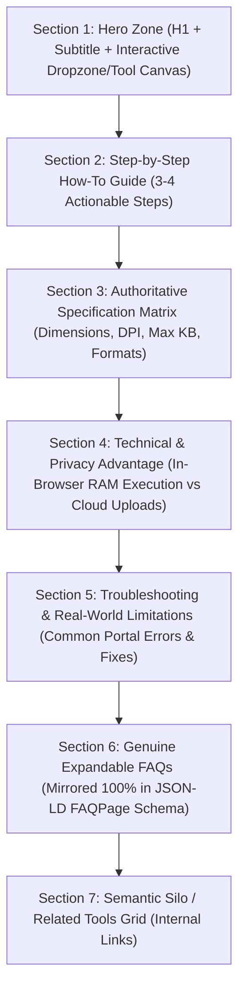
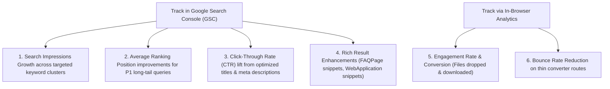

# FileWalaTool — Phase C: Research-Driven Content Enrichment Strategy
**Document Version:** 1.0.0  
**Status:** Strategic Blueprint (Approved for Review — Zero Production Code Modified)  
**Target Repository:** `https://github.com/mdsufidev/filewalatoolv2`  
**Production Domain:** `https://www.filewalatool.com`  
**Scope:** Complete 46-Route Content Architecture, Competitor Gap Analysis, Opportunity Matrix, Quality Standards & Concrete Prototypes

---

## Executive Summary & Strategic Scope

FileWalaTool has achieved **100% static prerendering and local technical SEO compliance across all 46 sitemap routes** (verified in Phase B Remediation with 0 hydration errors, 0 duplicate titles, 0 duplicate canonicals, and strict semantic `<h1>` validation). 

However, technical compliance is only table stakes. To win high-intent organic search traffic against entrenched incumbents—such as **iLovePDF** (global PDF giant), **Smallpdf**, and regional utility sites like **11zon** and **Pi7**—FileWalaTool must establish **content depth, search intent alignment, and clear value differentiation**.

### The Core Differentiator: The "Client-Side In-Browser" Privacy Moat

| Strategic Dimension | Incumbent Competitors (iLovePDF, Smallpdf) | Regional Tools (11zon, Pi7) | FileWalaTool Moat |
| :--- | :--- | :--- | :--- |
| **Architecture** | Remote Cloud Processing (Files uploaded to AWS/GCP servers) | Cloud or Mixed Server-Side | **100% In-Browser RAM Execution** (WebAssembly `pdf-lib`, HTML5 Canvas 2D, Web Workers) |
| **Privacy & Security** | Files stored temporarily on remote servers (1–2 hrs); compliance liability | Data logged/cached remotely; ad trackers | **Zero Server Uploads**: Bytes never leave the user's device. 100% safe for Aadhaar, PAN, Passports, Bank Statements |
| **Upload Latency** | High: Upload time + Processing time + Download time | Medium to High | **Near Zero Latency**: Instant local RAM execution without waiting for 50MB file uploads |
| **Usage Restrictions** | Freemium paywalls, daily task limits (1–3 files/day), file size caps, queue throttling | Cluttered with aggressive display/pop-under ads | **100% Free, Unlimited, No Signup, No Watermarks, Zero Ads** |
| **Regional Specialization** | Generic global tools; zero knowledge of Indian regulatory form specs | Primitive, inconsistent aspect ratios and frequent portal upload rejections | **Authoritative Portal Presets**: Exact pixel dimensions, DPI, and KB limits for NSDL, UTIITSL, UPSC OTR, SSC, Passport Seva |

### Phase C Scope Boundaries
- **Strictly Planning and Architecture**: No production tool logic, CSS styles, or page components are modified during this phase.
- **Evidence-Based Strategy**: All portal rules (UPSC, SSC, NSDL, Passport Seva) are verified against official government guidelines.
- **Search Data Integrity**: Verified portal specifications and browser technical capabilities are explicitly distinguished from search demand estimates.

---

## 1. Verified Route Inventory & Content Baseline

An automated audit of all 46 prerendered routes on disk (`dist/`) was performed to establish baseline word counts, heading integrity, FAQ presence, and schema integration.

```
Total Sitemap Routes Audited: 46
├── Tier 1: High-Monopoly Govt & Exam Compliance Tools : 7 routes  (Avg. 1,027 words)
├── Tier 2: Flagship Private PDF Processing Tools       : 8 routes  (Avg. 624 words)
├── Tier 3: Core Image Creative & Optimization Tools    : 11 routes (Avg. 509 words)
├── Tier 4: Client-Side Format Converter Suite         : 8 routes  (Avg. 215 words) ⚠️ THIN CONTENT GAP
├── Tier 5: Category Hubs & Directory                  : 6 routes  (Avg. 1,109 words)
└── Tier 6: Institutional, Desktop & Legal Trust Pages : 6 routes  (Avg. 474 words)
```

### Complete 46-Route Baseline Inventory Table

| # | Route | Category / Group | Word Count | Rendered H1 Heading | FAQ Visible? | FAQ Schema? | Identified Content State & Gaps |
| :- | :--- | :--- | :-: | :--- | :-: | :-: | :--- |
| 1 | `/` | Root / Flagship | 1,490 | Stop Worrying About Form Rejections. Ready in Seconds. | No | No | Broad homepage overview; lacks structured FAQ schema and internal silo clusters. |
| 2 | `/tools` | Directory Hub | 1,491 | All Free In-Browser File Tools & Document Utilities | No | No | Searchable directory; needs categorized thematic anchor links. |
| 3 | `/image-tools` | Category Hub | 927 | Free In-Browser Image Tools & Photo Optimizers | No | No | Tool grid; lacks educational guide on client-side canvas compression. |
| 4 | `/pdf-tools` | Category Hub | 708 | Private In-Browser PDF Tools & Document Utilities | No | No | Tool grid; needs comprehensive overview of in-browser Wasm PDF security. |
| 5 | `/convert-tools`| Category Hub | 757 | Fast Client-Side Format Converters — HEIC, WebP, PNG & JPG | No | No | Tool grid; needs modern vs legacy format decision guide. |
| 6 | `/document-tools`| Category Hub | 1,280 | Indian Government Document & Photo Resizer Suite | Yes | No | Rich portal matrix; needs FAQPage JSON-LD schema matching visible text. |
| 7 | `/image-resizer` | Image Tool | 715 | Image Resizer | Yes | Yes | Solid tool; needs pixel vs percentage aspect ratio calculation guide. |
| 8 | `/compress-image`| Image Tool | 742 | Image Compressor | Yes | Yes | Strong interactive tool; needs image quality vs byte reduction benchmarks. |
| 9 | `/pan-photo-resize`| Govt Tool | 1,095 | PAN Photo Resizer & DPI Formatter | Yes | Yes | High quality; needs NSDL Protean vs UTIITSL distinct dimension matrix. |
| 10 | `/signature-resize`| Govt Tool | 1,121 | PAN Signature Resizer & DPI Formatter | Yes | Yes | High quality; needs clear ink color guidelines and contrast boost advice. |
| 11 | `/passport-photo`| Govt Tool | 984 | Passport Seva Photo Resizer | Yes | Yes | High quality; needs MEA 35x45mm biometric framing diagram/explanation. |
| 12 | `/passport-signature-resize`| Govt Tool| 916 | Passport Seva Signature Resizer | Yes | Yes | High quality; needs 400x200 px vs 4x2 cm dimension conversion guide. |
| 13 | `/upsc-photo-maker`| Govt Tool | 954 | UPSC Photo Maker with Name & Date Stamp | Yes | Yes | Authoritative; needs updated UPSC OTR 10-day recency rule and live photo advice. |
| 14 | `/ssc-photo-signature`| Govt Tool| 912 | SSC Photo & Signature Resizer | Yes | Yes | High quality; needs update explaining SSC new portal live capture vs 10-20KB signature upload. |
| 15 | `/kb-resizer` | Govt Tool | 1,026 | General Gov Form Document Compressor | Yes | Yes | Strong; needs specific target KB presets for Aadhaar, Marksheets, and Caste certificates. |
| 16 | `/merge-pdf` | PDF Tool | 605 | Merge PDF Files | Yes | Yes | Good tool; needs deep technical comparison vs iLovePDF cloud upload. |
| 17 | `/compress-pdf`| PDF Tool | 633 | Compress PDF Files | Yes | Yes | Good tool; needs explanation of vector stream vs raster downsampling. |
| 18 | `/crop-image` | Image Tool | 720 | Crop & Rotate Tool | Yes | No | Good tool; lacks FAQPage schema and social media aspect ratio table. |
| 19 | `/bg-remover` | Image Tool | 554 | Instant Background Remover | Yes | No | Good tool; needs guide on transparent PNG vs passport solid background export. |
| 20 | `/split-pdf` | PDF Tool | 601 | Split PDF & Extract Pages | Yes | No | Good tool; lacks FAQPage schema and page range syntax examples. |
| 21 | `/rotate-pdf` | PDF Tool | 593 | Rotate PDF Pages | Yes | No | Good tool; lacks FAQPage schema and permanent orientation metadata guide. |
| 22 | `/pdf-to-image`| PDF Tool | 777 | PDF to Image Converter | Yes | No | Strong tool; needs multi-page ZIP extraction guide and DPI explanation. |
| 23 | `/image-to-pdf`| PDF Tool | 605 | Image to PDF Converter | Yes | Yes | Good tool; needs custom margins, A4 fit, and orientation presets guide. |
| 24 | `/pdf-to-word` | PDF Tool | 629 | Convert PDF to Word | Yes | Yes | Good tool; needs realistic limitations of client-side DOM DOCX reconstruction. |
| 25 | `/pdf-to-text` | PDF Tool | 637 | PDF to Searchable Text (OCR) | Yes | No | Good tool; needs client-side Tesseract.js language support explanation. |
| 26 | `/jpg-to-png` | Format Converter | 213 | JPG to PNG Converter | No | No | ⚠️ **Thin content**: Dropzone only. Needs format guide, lossy vs lossless, FAQs. |
| 27 | `/png-to-jpg` | Format Converter | 215 | PNG to JPG Converter | No | No | ⚠️ **Thin content**: Needs transparency handling explanation (white background fill). |
| 28 | `/heic-to-jpg`| Format Converter | 217 | HEIC to JPG Converter | No | No | ⚠️ **Thin content**: High search volume. Needs iPhone iOS HEIC compatibility guide. |
| 29 | `/png-to-webp`| Format Converter | 215 | PNG to WebP Converter | No | No | ⚠️ **Thin content**: Needs Web performance & Core Web Vitals optimization guide. |
| 30 | `/webp-to-jpg`| Format Converter | 213 | WebP to JPG Converter | No | No | ⚠️ **Thin content**: Needs legacy browser & desktop software compatibility guide. |
| 31 | `/jpg-to-webp`| Format Converter | 215 | JPG to WebP Converter | No | No | ⚠️ **Thin content**: Needs page speed optimization and byte reduction comparison. |
| 32 | `/avif-to-jpg`| Format Converter | 215 | AVIF to JPG Converter | No | No | ⚠️ **Thin content**: Needs next-gen AV1 codec decode explanation. |
| 33 | `/svg-to-png` | Format Converter | 214 | SVG to PNG Converter | No | No | ⚠️ **Thin content**: Needs vector rasterization and high-DPI scaling guide. |
| 34 | `/watermark-image`| Image Sub-Tool | 323 | Image Watermarker (Add Text / Logo) | No | No | ⚠️ **Thin content**: Needs copyright protection and opacity control guide. |
| 35 | `/round-corners` | Image Sub-Tool | 323 | Rounded Corner Image Maker | No | No | ⚠️ **Thin content**: Needs avatar creation and border-radius guide. |
| 36 | `/meme-generator`| Image Sub-Tool | 323 | Meme Generator & Image Captioner | No | No | ⚠️ **Thin content**: Needs meme templates and social media export guide. |
| 37 | `/color-palette` | Image Sub-Tool | 326 | Color Palette Extractor (Image Color Picker) | No | No | ⚠️ **Thin content**: Needs UI/UX design, HEX/RGB codes, eyedropper guide. |
| 38 | `/image-to-base64`| Image Sub-Tool| 323 | Image to Base64 Converter | No | No | ⚠️ **Thin content**: Needs developer guide for CSS/HTML inline embedding. |
| 39 | `/batch-image-cropper`| Image Sub-Tool| 320 | Batch Image Processor | No | No | ⚠️ **Thin content**: Needs multi-file workflow and client memory batching guide. |
| 40 | `/filter-adjust` | Image Sub-Tool | 315 | Filters & Watermark | No | No | ⚠️ **Thin content**: Needs brightness/contrast and photo tuning guide. |
| 41 | `/desktop` | Desktop App | 693 | FileWala Desktop for Windows: Offline AI Picture Enhancer & BG Remover | Yes | No | Good landing page; needs system requirements table and SHA256 verification. |
| 42 | `/about` | Static / E-E-A-T | 454 | Private, in-browser file utilities. Built for zero compromise. | No | No | Good founder story (@mdsufidev); needs Person schema and credentials. |
| 43 | `/contact` | Static / Support | 227 | Get in Touch with Us | No | No | Functional contact form; needs expected response times and support channels. |
| 44 | `/privacy` | Legal / Trust | 492 | Privacy Policy & Zero-Upload Guarantee | No | No | High-quality client-side privacy architecture explanation. |
| 45 | `/terms` | Legal / Terms | 486 | Terms and Conditions | No | No | Standard client-side terms of service. |
| 46 | `/disclaimer` | Legal / E-E-A-T | 484 | Privacy & Compliance Disclaimer | No | No | Critical non-affiliation disclaimer with Indian government portals. |

---

## 2. Competitor Research & Value Differentiation

### Competitor Vulnerability Analysis

```mermaid
flowchart TD
    subgraph Competitor["Legacy Competitors: iLovePDF / Smallpdf / 11zon"]
        C1["User selects confidential PDF / ID"] --> C2["File uploaded over Internet to Cloud Server"]
        C2 --> C3["Server processes file in temporary container"]
        C3 --> C4["Processed file saved to disk / S3 bucket"]
        C4 --> C5["User downloads file back from server"]
        C5 --> C6["File queued for deletion (1-2 hours)"]
        style C2 fill:#fee2e2,stroke:#ef4444
        style C4 fill:#fee2e2,stroke:#ef4444
        style C6 fill:#fee2e2,stroke:#ef4444
    end

    subgraph FileWala["FileWala Architecture: 100% In-Browser RAM"]
        F1["User drops confidential PDF / ID"] --> F2["File loaded directly into Local Browser RAM"]
        F2 --> F3["WebAssembly (pdf-lib) / HTML5 Canvas executes locally"]
        F3 --> F4["Blob URL generated directly from RAM"]
        F4 --> F5["File saved to Downloads folder instantly"]
        style F2 fill:#dcfce7,stroke:#22c55e
        style F3 fill:#dcfce7,stroke:#22c55e
        style F4 fill:#dcfce7,stroke:#22c55e
    end
```



### Analysis of Competitor Strategies

#### 1. iLovePDF (`ilovepdf.com`) & Smallpdf (`smallpdf.com`)
- **Strengths**: Dominant brand search volume, massive domain authority (DA 80+), established backlink profiles, comprehensive desktop and mobile apps.
- **Critical Weaknesses**:
  - **Data Privacy & Corporate Security**: Enterprise users, lawyers, accountants, healthcare workers, and government applicants cannot legally or safely upload confidential tax returns, Aadhaar numbers, PAN scans, or NDAs to third-party servers.
  - **Friction & Paywalls**: Severe free-tier restrictions (maximum 2–3 tasks per day, file size throttles, queue delays, aggressive prompts to upgrade to €7/month subscriptions).
  - **Lack of Indian Regulatory Relevance**: Zero tools tailored for specific Indian administrative and exam requirements (UPSC OTR, NSDL PAN, SSC CGL, Passport Seva).
- **FileWala Counter-Strategy**: Target privacy-conscious queries ("private merge pdf without upload", "offline pdf compressor", "bank statement pdf merge safely") and position FileWala as the zero-upload, zero-cost alternative.

#### 2. 11zon (`11zon.com`) & Pi7 (`pi7.org`)
- **Strengths**: Strong rankings for Indian long-tail queries ("resize photo to 20kb", "pan card photo resizer 200 dpi", "reduce image to 50kb").
- **Critical Weaknesses**:
  - **Terrible User Experience**: Excessive banner ads, interstitial pop-ups, misleading "Download" buttons, and slow mobile layout shifts (poor Core Web Vitals).
  - **Inaccurate Dimension Outputs**: Many tools apply simple CSS rescaling or lossy downsampling without correctly setting internal EXIF/JFIF 200/300 DPI metadata, causing portal upload rejections.
  - **Thin, Low-Trust Content**: Automated keyword-stuffed text without verified instructions or clear authorship.
- **FileWala Counter-Strategy**: Provide a clean, fast, ad-free UI, genuine verified portal specifications, automated EXIF DPI embedding, and authoritative step-by-step guides.

---

## 3. The 46-Route Opportunity Matrix

Below is the comprehensive keyword-intent, gap analysis, and enrichment plan across all 46 sitemap routes.

### Tier 1: Government & Exam Compliance Suite (P1 — High Monopoly)

#### Route 9: `/pan-photo-resize`
- **Target Audience:** Indian citizens and CSC/cyber café operators applying for new PAN cards or corrections via NSDL (Protean) or UTIITSL.
- **Search Intent:** Strict compliance / transactional. High urgency; users need an exact 200x230 px or 213x213 px photo under 50 KB at 200 DPI to prevent portal rejection.
- **Primary Keyword:** `pan card photo resize`
- **Secondary Keywords:** `pan card photo size 200x230`, `nsdl photo resizer 200 dpi`, `utiitsl pan photo size 213x213`, `resize photo for pan card online free`, `pan photo resizer under 50kb`.
- **Existing Content Gaps:** Lacks a side-by-side comparison table between NSDL Protean (3.5x2.5cm, 200 DPI) and UTIITSL (213x213px, 300 DPI); lacks troubleshooting for "Invalid file format / dimensions" error.
- **Proposed Optimization:**
  - **Title:** `PAN Card Photo Resizer 200x230 px (NSDL & UTIITSL 200 DPI) | FileWala`
  - **H1:** `PAN Card Photo Resizer & 200 DPI Formatter`
  - **Content Additions:** Specification comparison table (NSDL vs UTIITSL), step-by-step guide, explanation of why 200 DPI metadata matters, 5 verified FAQs.

#### Route 10: `/signature-resize`
- **Target Audience:** PAN card applicants needing signature formatting.
- **Search Intent:** Transactional compliance. Must produce a 354x157 px (NSDL) or 400x200 px (UTIITSL) image under 50 KB with a pure white background.
- **Primary Keyword:** `pan card signature resize`
- **Secondary Keywords:** `pan card signature size 354x157`, `nsdl signature resizer under 50kb`, `uti pan signature size 600 dpi`, `pan signature resize online free`, `how to resize signature for pan card`.
- **Existing Content Gaps:** Missing instructions on ink color (black/dark blue ballpoint), paper requirements (unruled white paper), and how to remove shadows from mobile photos.
- **Proposed Optimization:**
  - **Title:** `PAN Card Signature Resizer 354x157 px (< 50 KB, 200 DPI) | FileWala`
  - **H1:** `PAN Card Signature Resizer & Background Contrast Booster`
  - **Content Additions:** Ink & paper requirements guide, contrast enhancement explanation, dimension matrix, 5 verified FAQs.

#### Route 11: `/passport-photo`
- **Target Audience:** Indian citizens applying on Passport Seva (`passportindia.gov.in`) or Indian Visa online portals.
- **Search Intent:** High compliance. Requires 350x450 px (35x45 mm), 300 DPI, under 300 KB, with 70–80% face coverage.
- **Primary Keyword:** `passport photo maker 35x45 mm`
- **Secondary Keywords:** `indian passport photo size 350x450`, `passport seva photo resizer under 300kb`, `35mm x 45mm photo converter online`, `passport photo 300 dpi online free`.
- **Existing Content Gaps:** Lacks MEA biometric guidelines (eye level, neutral expression, white background, no spectacles/glare, ears visible).
- **Proposed Optimization:**
  - **Title:** `Passport Photo Maker 350x450 px (35x45 mm, 300 DPI) | FileWala`
  - **H1:** `Indian Passport Seva Photo Resizer (35x45 mm)`
  - **Content Additions:** Biometric framing checklist, background lighting tips, MEA specification table, 5 verified FAQs.

#### Route 12: `/passport-signature-resize`
- **Target Audience:** Passport Seva applicants uploading signature scans.
- **Search Intent:** Compliance utility. Requires 400x200 px (4x2 cm), under 100 KB, 300 DPI.
- **Primary Keyword:** `passport seva signature resizer`
- **Secondary Keywords:** `passport signature size 400x200`, `indian passport signature dimensions 4x2 cm`, `passport signature under 100kb`, `resize signature for passport application`.
- **Existing Content Gaps:** Lacks guidance on aspect ratio locking and high-DPI stroke preservation.
- **Proposed Optimization:**
  - **Title:** `Passport Signature Resizer 400x200 px (< 100 KB, 300 DPI) | FileWala`
  - **H1:** `Passport Seva Signature Resizer & DPI Formatter`
  - **Content Additions:** Step-by-step scanning guide, stroke sharpness preservation explanation, 5 verified FAQs.

#### Route 13: `/upsc-photo-maker`
- **Target Audience:** UPSC CSE, NDA, CDS, and OTR applicants.
- **Search Intent:** Exam compliance. Strictly square (350x350 to 1000x1000 px), 20–300 KB, with **Candidate Full Name and Date of Photo (DoP)** printed on the bottom, not older than 10 days.
- **Primary Keyword:** `upsc photo maker with name and date`
- **Secondary Keywords:** `upsc otr photo resizer 350x350`, `upsc photo size 20 to 300 kb`, `upsc signature triple signature format`, `dop photo maker for upsc online free`.
- **Existing Content Gaps:** Missing coverage of the **Triple Signature rule** (signing 3 times vertically on one sheet) and the **Live Photo capture** cross-matching rule on UPSC OTR.
- **Proposed Optimization:**
  - **Title:** `UPSC Photo Maker Online - Name & Date Stamp (DOP) 350x350 | FileWala`
  - **H1:** `UPSC Photo Maker with Candidate Name & Date Stamp (OTR Compliant)`
  - **Content Additions:** Explanation of the 10-day recency rule, Triple Signature scanning instructions, OTR live photo correlation guidelines, 5 verified FAQs.

#### Route 14: `/ssc-photo-signature`
- **Target Audience:** SSC CGL, CHSL, MTS, and GD Constable applicants.
- **Search Intent:** Exam compliance.
- **Primary Keyword:** `ssc signature resizer 10 to 20 kb`
- **Secondary Keywords:** `ssc photo and signature size`, `ssc cgl signature resize 140x60`, `ssc new portal live photo guidelines`, `ssc signature resize online free`.
- **Existing Content Gaps:** Critical recent regulatory change: SSC's new portal (`ssc.gov.in`) uses **Live Webcam Capture** for photos, but **still mandates uploaded signatures strictly between 10 KB to 20 KB (140x60 px)**. Explaining this eliminates applicant confusion and establishes high E-E-A-T.
- **Proposed Optimization:**
  - **Title:** `SSC Signature Resizer (10–20 KB) & Photo Guidelines | FileWala`
  - **H1:** `SSC Signature Resizer (Strictly 10–20 KB) & Live Photo Guide`
  - **Content Additions:** Clarification of the new live capture vs file upload rules, signature dimension standards, 5 verified FAQs.

#### Route 15: `/kb-resizer`
- **Target Audience:** General government job applicants (State PSCs, Railway RRB, Banking IBPS, Police, Teaching exams, EPFO, College admissions).
- **Search Intent:** Direct utility / problem solving. Users have a file that exceeds portal limits (e.g., must be under 20KB, 50KB, 100KB, or 200KB).
- **Primary Keyword:** `reduce image size in kb`
- **Secondary Keywords:** `compress photo to 20kb online`, `resize image under 50kb`, `reduce certificate size to 100kb`, `compress photo to 200kb for sarkari exam`.
- **Existing Content Gaps:** Missing quick-preset tabs for standard exam thresholds (20KB, 50KB, 100KB, 200KB) and guidance on preserving text readability on Aadhaar cards and marksheets.
- **Proposed Optimization:**
  - **Title:** `Reduce Image Size in KB - 20KB, 50KB, 100KB & 200KB Presets | FileWala`
  - **H1:** `Government Document & Certificate KB Compressor`
  - **Content Additions:** Table of portal file size limits (Aadhaar, Caste, Marksheet, Signature), binary search compression explanation, 5 verified FAQs.

---

### Tier 2: Flagship In-Browser PDF Suite (P2 — Competitive against iLovePDF)

#### Route 16: `/merge-pdf`
- **Target Audience:** Office workers, students, legal professionals, accountants merging sensitive documents.
- **Search Intent:** High volume utility. Direct competition with iLovePDF.
- **Primary Keyword:** `merge pdf online free`
- **Secondary Keywords:** `combine pdf files without upload`, `private pdf merger in browser`, `merge confidential pdf safely`, `combine pdf no size limit`.
- **Existing Content Gaps:** Does not explicitly market its privacy advantage against iLovePDF cloud storage.
- **Proposed Optimization:**
  - **Title:** `Merge PDF Files Online - 100% Private In-Browser | FileWala`
  - **H1:** `Merge PDF Files Locally with Zero Cloud Uploads`
  - **Content Additions:** Technical explanation of `pdf-lib` WebAssembly execution in RAM, drag-to-reorder instructions, zero-upload privacy comparison, 5 verified FAQs.

#### Route 17: `/compress-pdf`
- **Target Audience:** Users needing smaller PDF files for email attachments, government portals, or court filings.
- **Search Intent:** Problem-solving. Incumbent tools either charge or enforce strict daily caps.
- **Primary Keyword:** `compress pdf online free`
- **Secondary Keywords:** `reduce pdf file size under 100kb`, `compress pdf without losing quality`, `client side pdf compressor`, `compress pdf offline free`.
- **Existing Content Gaps:** Lacks explanation of lossy image downsampling vs lossless PDF stream deflating.
- **Proposed Optimization:**
  - **Title:** `Compress PDF Online Free - Reduce File Size Privately | FileWala`
  - **H1:** `Compress PDF Files in Browser RAM with Zero Data Loss`
  - **Content Additions:** Compression modes explanation (Extreme vs Recommended vs Low), visual fidelity guide, 5 verified FAQs.

#### Route 20: `/split-pdf`
- **Target Audience:** Users extracting specific page ranges or isolating individual chapters/pages from large PDF files.
- **Primary Keyword:** `split pdf online free`
- **Secondary Keywords:** `extract pages from pdf`, `separate pdf pages without upload`, `split pdf by page range`, `private pdf splitter`.
- **Content Gaps:** Lacks syntax examples for page extraction (e.g. `1-5, 8, 11-14`) and FAQPage schema.

#### Route 21: `/rotate-pdf`
- **Target Audience:** Users fixing upside-down or sideways scanned PDF pages.
- **Primary Keyword:** `rotate pdf pages permanently`
- **Secondary Keywords:** `rotate pdf 90 degrees online`, `fix sideways pdf scan`, `permanent pdf page orientation`, `rotate pdf in browser`.
- **Content Gaps:** Lacks explanation of permanent metadata rotation vs temporary browser viewport rotation, and FAQPage schema.

#### Route 22: `/pdf-to-image`
- **Target Audience:** Users needing to convert multi-page PDF documents into JPG, PNG, or WebP images.
- **Primary Keyword:** `pdf to image converter online`
- **Secondary Keywords:** `convert pdf to jpg high resolution`, `extract images from pdf`, `pdf to png 300 dpi`, `pdf to jpg bulk zip download`.
- **Content Gaps:** Lacks explanation of canvas DPI rendering scale (1x, 2x Retina, 3x Print) and multi-image ZIP bundling.

#### Route 23: `/image-to-pdf`
- **Target Audience:** Users creating single PDF portfolios from receipts, scans, or photos.
- **Primary Keyword:** `convert image to pdf online`
- **Secondary Keywords:** `jpg to pdf combiner`, `png to pdf converter free`, `convert photos to single pdf document`, `image to pdf no watermark`.
- **Content Gaps:** Lacks guide on page margin presets (No margin, Small, Large) and page orientation alignment (Auto-detect vs Portrait vs Landscape).

#### Route 24: `/pdf-to-word`
- **Target Audience:** Users needing editable Word documents from PDFs.
- **Primary Keyword:** `convert pdf to word online free`
- **Secondary Keywords:** `pdf to docx editable`, `convert pdf to word without email`, `private pdf to word in browser`.
- **Content Gaps:** Must provide an honest, transparent explanation of client-side DOM DOCX reconstruction vs server-side OCR to prevent user frustration with complex tabular layouts.

#### Route 25: `/pdf-to-text`
- **Target Audience:** Researchers, students, and clerks extracting raw text or scanning document text.
- **Primary Keyword:** `pdf to text ocr online free`
- **Secondary Keywords:** `extract text from scanned pdf`, `client side tesseract ocr`, `convert pdf to searchable text`, `copy text from protected pdf`.
- **Content Gaps:** Lacks guide on OCR language model downloading into browser cache and image preprocessing tips.

---

### Tier 3: Core Image Creative & Optimization Suite (P2)

#### Route 7: `/image-resizer`
- **Primary Keyword:** `resize image online by pixels`
- **Secondary Keywords:** `image resizer percentage`, `scale image with aspect ratio`, `resize photo for website`, `bulk image resizer in browser`.
- **Content Additions:** Aspect ratio calculator guide (16:9, 4:3, 1:1, 3:2), bicubic resampling explanation, 5 verified FAQs.

#### Route 8: `/compress-image`
- **Primary Keyword:** `compress image online without losing quality`
- **Secondary Keywords:** `reduce jpg file size`, `png compressor client side`, `webp compression tool`, `image optimizer for web speed`.
- **Content Additions:** Quality vs file size tradeoff curve, Core Web Vitals optimization guide, 5 verified FAQs.

#### Route 18: `/crop-image`
- **Primary Keyword:** `crop image online free`
- **Secondary Keywords:** `circle crop photo`, `social media image cropper (Instagram, YouTube banner)`, `freeform photo crop`.
- **Content Additions:** Standard aspect ratio cheat sheet for social media platforms, 5 verified FAQs.

#### Route 19: `/bg-remover`
- **Primary Keyword:** `remove image background online free`
- **Secondary Keywords:** `instant transparent background png`, `passport blue background photo maker`, `white background photo converter`.
- **Content Additions:** Guide on edge feathering, subject isolation, passport white/blue replacement presets, 5 verified FAQs.

#### Routes 34–40: Sub-Tools (`/watermark-image`, `/round-corners`, `/meme-generator`, `/color-palette`, `/image-to-base64`, `/batch-image-cropper`, `/filter-adjust`)
- **Current Issue:** Thin content (~320 words each), dropzone/canvas only.
- **Strategic Fix:** Expand each page with:
  1. A 3-step "How It Works" guide.
  2. A dedicated use-case section (e.g. `/image-to-base64`: CSS embedding, email HTML; `/color-palette`: UI/UX design, HEX/RGB copying; `/round-corners`: profile avatar badges).
  3. 4 genuine, tool-specific FAQs.
  4. Internal cross-links to sibling image tools.

---

### Tier 4: Client-Side Format Converter Suite (P2 — High Volume Thin Content Fix)

All 8 format converter pages currently have **~215 words**, consisting only of the converter card without supporting educational content.

```
Format Converter Matrix (8 Routes):
├── /heic-to-jpg   : Primary: "heic to jpg converter online" (Massive iPhone iOS demand)
├── /png-to-webp   : Primary: "png to webp converter" (Web developers, PageSpeed)
├── /webp-to-jpg   : Primary: "webp to jpg converter online" (Compatibility, legacy apps)
├── /jpg-to-png    : Primary: "convert jpg to png online" (Raster preservation, graphics)
├── /png-to-jpg    : Primary: "png to jpg white background" (Removing alpha, reducing weight)
├── /jpg-to-webp   : Primary: "jpg to webp converter" (Core Web Vitals, image weight)
├── /avif-to-jpg   : Primary: "avif to jpg converter" (Modern AV1 codec compatibility)
└── /svg-to-png    : Primary: "svg to png high resolution" (Vector rasterization)
```

**Standardized Content Enrichment Plan for All 8 Converter Routes:**
1. **Technical Format Comparison Table:** Compare Source vs Target across 5 metrics: Compression efficiency, Transparency support, Browser compatibility, Best use cases, Lossy vs Lossless.
2. **Step-by-Step "How to Convert":** Clear 3-step ordered list.
3. **Transparency Handling Explanation:** Explicitly explain how alpha channels are handled (e.g., in `png-to-jpg`, FileWala fills transparent pixels with pure white to avoid black canvas glitches).
4. **4 Dedicated FAQs & FAQPage Schema:** Directly addressing user questions about quality degradation, file size differences, and browser security.

---

### Tier 5 & 6: Hubs, Directory & Institutional Trust Pages (P3)

#### Hubs (`/`, `/tools`, `/image-tools`, `/pdf-tools`, `/convert-tools`, `/document-tools`)
- **Current State:** Clean visual tool grid and headings, but lack introductory topical authority content.
- **Enrichment:**
  - Add a 150-word editorial overview explaining the category's utility and security benefits.
  - Implement a structured FAQ accordion addressing general category questions.
  - Establish a clean **Hub-and-Spoke internal linking architecture** passing link equity down to individual tool pages.

#### Institutional & Legal Pages (`/about`, `/desktop`, `/contact`, `/privacy`, `/terms`, `/disclaimer`)
- **`/about`**: Add rich `Person` schema for Mohammad Sufiyan (`@mdsufidev`), link to GitHub profile, specify programming stack, and outline the vision of serverless, private file tools.
- **`/desktop`**: Add Windows 64-bit system requirements table, offline AI execution guide, and SHA256 checksum verification instructions.
- **`/disclaimer`**: Maintain prominent non-affiliation disclaimers with government bodies (E-E-A-T requirement).

---

## 4. Content Architecture & Quality Standards

To maintain high search quality ratings (Google E-E-A-T guidelines) and provide genuine user utility, all enriched content must adhere to strict structural and editorial rules.

### Standardized Tool Landing Page Content Blueprint



### Editorial & Quality Guidelines

#### 1. E-E-A-T & Strict Non-Affiliation Compliance
> [!IMPORTANT]
> FileWala is an independent open utility. Under no circumstances should any copy suggest, imply, or state that FileWala is affiliated with, endorsed by, or operated by any government ministry or agency (UPSC, SSC, Income Tax Department, NSDL, Protean, UTIITSL, MEA).

- **Mandatory Disclaimer Banner on All Government Tool Pages:**
  *"FileWala is an independent document utility and is not affiliated with, endorsed by, or operated by any government body. Portal specifications are aggregated from publicly available guidelines. Always review the official notification before submitting your application."*
- **Zero False Promises:** Never claim "Guaranteed 100% form acceptance." State instead: *"Formatted strictly according to standard portal dimensional and file-size guidelines."*

#### 2. Technical Limitations Transparency
To earn long-term user trust and minimize bounce rates, explicitly state realistic tool boundaries:
- **Device Memory Limits:** Since files are processed client-side in browser RAM, very large files (>500MB on mobile devices or >1GB on desktop) may cause browser tab memory strain.
- **Complex PDF Layouts:** In `/pdf-to-word`, clarify that scanned multi-column PDFs without underlying text layers will export extracted raster graphics rather than native editable typography.

#### 3. Strict Schema.org Synchronization Rule
In accordance with Google Search Central guidelines:
- **Never emit hidden JSON-LD FAQs.** Every question and answer emitted in the `@type: FAQPage` structured data script must be visible and readable on the rendered page DOM.
- **Decoded Entities:** Ensure JSON-LD content uses clean characters rather than double-encoded entities (`&amp;` -> `&`).

---

## 5. Concrete Content Enrichment Prototypes

Below are full, production-ready copy blueprints for three representative priority routes across different tiers.

---

### Prototype 1: `/pan-photo-resize` (Tier 1 Govt Flagship)

#### Metadata Configuration
- **URL:** `https://www.filewalatool.com/pan-photo-resize`
- **Title:** `PAN Card Photo Resizer 200x230 px (NSDL & UTIITSL 200 DPI) | FileWala`
- **Meta Description:** `Resize photo for PAN Card online. Exactly 200x230 px (NSDL Protean) or 213x213 px (UTIITSL), 200 DPI, under 50 KB. 100% private in-browser tool with zero server uploads.`
- **Canonical URL:** `https://www.filewalatool.com/pan-photo-resize`

#### Rendered Page Content

```markdown
# PAN Card Photo Resizer & 200 DPI Formatter

Resize your passport-style photograph to exact NSDL Protean (200×230 px) or UTIITSL (213×213 px) portal specifications in seconds. Runs 100% in your local browser with zero cloud uploads—keeping your personal photo completely private and secure.

[ INTERACTIVE TOOL CANVAS: PAN Photo Resizer Dropzone & Preset Controls ]

---

## How to Resize Your Photo for PAN Card Application

1. **Upload Your Photograph:** Drag and drop your passport-size photo (JPEG, PNG, or WebP) into the workspace above. Your image is loaded directly into browser memory and is never uploaded to any server.
2. **Select Your Portal Preset:** Choose **NSDL / Protean** (200 × 230 pixels, 200 DPI) or **UTIITSL** (213 × 213 pixels, 300 DPI) depending on which agency portal you are applying through.
3. **Fine-Tune Framing:** Use the zoom and pan controls to center your face within the guide box. Ensure your face covers approximately 70% to 80% of the frame.
4. **Download Compliant JPEG:** Click "Download Formatted Photo". The downloaded image will be strictly under 50 KB, correctly formatted in true JPEG, with embedded 200 DPI resolution metadata.

---

## Official PAN Card Photo Specifications Matrix

| Specification Parameter | NSDL / Protean Portal | UTIITSL Portal | FileWala Automated Setting |
| :--- | :--- | :--- | :--- |
| **Physical Dimensions** | 3.5 cm × 2.5 cm (Portrait) | 2.5 cm × 2.5 cm (Square) | Automatically scaled |
| **Pixel Dimensions** | **200 × 230 pixels** (or 197 × 276 px) | **213 × 213 pixels** | Exact pixel output |
| **Resolution / DPI** | **200 DPI** | **300 DPI** | Embedded JFIF metadata |
| **Maximum File Size** | Strictly under **50 KB** | Strictly under **30 KB** | Enforced under 45 KB / 28 KB |
| **Permitted Format** | JPEG / JPG only | JPEG / JPG only | Standard baseline JPEG |
| **Background Color** | Plain white or light background | Plain white background | Contrast boost available |
| **Face Alignment** | Frontal view, both ears visible | Frontal view, both ears visible | Visual framing guide |

---

## Why 100% Client-Side Privacy Matters for PAN Photos

When applying for financial credentials such as an Indian Permanent Account Number (PAN), your photograph and signature are sensitive biometric identifiers. 

Traditional online photo resizers upload your image to third-party web servers, where files may be cached, logged, or temporarily stored in cloud storage buckets. **FileWala operates with a zero-upload privacy architecture:**

- **Local RAM Execution:** Resizing, bicubic pixel resampling, and JPEG encoding are executed exclusively by your browser's HTML5 Canvas engine.
- **Zero Cloud Footprint:** No bytes, image data, or metadata ever leave your computer or phone.
- **Instant Processing:** Because no network file upload or server download occurs, your photo is formatted instantly, even on slow mobile connections.

---

## Troubleshooting Common PAN Portal Upload Errors

- **Error: "File size exceeds 50 KB":** PAN portals strictly reject images at 50,001 bytes or larger. FileWala's compressor automatically constrains files to 30–45 KB to ensure a safe buffer.
- **Error: "Invalid image DPI / resolution":** Many photo editors export images at 72 or 96 DPI. FileWala explicitly encodes the 200 DPI JFIF header required by NSDL validation scripts.
- **Error: "Invalid file format":** Some portals reject PNG files renamed as `.jpg`. FileWala performs a genuine client-side raster conversion to baseline JPEG.

---

## Frequently Asked Questions

### 1. What are the exact photo dimensions for an NSDL PAN card application?
For the Protean (NSDL) online portal, your photograph should be 3.5 cm × 2.5 cm, which corresponds to 200 × 230 pixels (or 197 × 276 pixels depending on the specific form pathway), at a resolution of 200 DPI and a file weight strictly below 50 KB.

### 2. Can I use the same photo for both NSDL and UTIITSL portals?
No. NSDL requires a rectangular aspect ratio (200 × 230 px), whereas UTIITSL requires a square aspect ratio (213 × 213 px at 300 DPI, max 30 KB). Using an NSDL-formatted rectangular photo on UTIITSL will trigger an aspect ratio rejection error. Select the appropriate preset in FileWala before downloading.

### 3. Does this tool upload my photo to any server?
No. 100% of processing occurs in your web browser's local memory. No files, personal images, or technical data are ever transmitted to or stored on FileWala servers.

### 4. What color background is required for a PAN card photo?
Both NSDL and UTIITSL guidelines mandate a plain, light-colored background—preferably pure white. Avoid photos taken against patterned wallpapers, outdoor landscapes, or textured walls.

### 5. Can I wear eyeglasses or a cap in my PAN card photo?
Spectacles with clear lenses are acceptable if there is no glare or reflection obscuring your eyes. Tinted glasses, sunglasses, hats, caps, and scarves (except for documented religious headwear that does not obscure facial contours) are strictly prohibited.

---

> [!NOTE]
> **Regulatory Disclaimer:** FileWala is an independent utility and is not affiliated with, endorsed by, or operated by the Income Tax Department of India, Protean eGov Technologies (NSDL), or UTIITSL. Guidelines are provided for informational convenience.
```

---

### Prototype 2: `/merge-pdf` (Tier 2 PDF Flagship)

#### Metadata Configuration
- **URL:** `https://www.filewalatool.com/merge-pdf`
- **Title:** `Merge PDF Files Online - 100% Private In-Browser | FileWala`
- **Meta Description:** `Combine multiple PDF files into one document in seconds. 100% client-side WebAssembly processing with zero server uploads, no file size limits, and complete privacy.`
- **Canonical URL:** `https://www.filewalatool.com/merge-pdf`

#### Rendered Page Content

```markdown
# Merge PDF Files Online

Combine multiple PDF documents into a single, organized file directly inside your browser. No cloud uploads, no daily task limits, and complete confidentiality for your legal, financial, and personal records.

[ INTERACTIVE TOOL CANVAS: Drag & Drop Multi-PDF Workspace + Reorder Page Grid ]

---

## How to Merge Multiple PDFs into One Document

1. **Add Your PDF Files:** Click "Select PDF Files" or drag and drop two or more documents into the workspace. All files are loaded locally into browser RAM.
2. **Arrange File Sequence:** Drag and drop the document cards to set the exact page sequence. You can also remove individual files or rotate orientation before merging.
3. **Execute Client-Side Merge:** Click "Merge PDF Files". The WebAssembly engine (`pdf-lib`) stitches the internal cross-reference tables and content streams entirely in browser memory.
4. **Download Combined File:** Save your unified PDF immediately. No waiting for server rendering queues or email links.

---

## The Secure Alternative to Cloud-Based PDF Tools

Most popular PDF utilities (including iLovePDF and Smallpdf) require you to upload your complete document to remote cloud servers for processing. For sensitive documents, this presents significant privacy and compliance concerns:

| Feature Comparison | Standard Cloud PDF Mergers | FileWala Client-Side PDF Merger |
| :--- | :--- | :--- |
| **File Processing Location** | Remote Third-Party Servers (AWS, GCP) | **Local Device Memory (Browser RAM)** |
| **Data Privacy & Leak Risk** | Files cached remotely for 1–2 hours | **Zero Uploads: 100% Confidential** |
| **Task / Quantity Limits** | 2–3 free merges per day; paywall popups | **Unlimited merges; completely free** |
| **File Size Constraints** | Strict free tier caps (e.g., 15–50 MB) | **No artificial limits (governed by your RAM)** |
| **Network Speed Dependency** | Slow (Upload time + Processing + Download) | **Near-instantaneous local execution** |
| **Confidential Document Safety**| High risk for bank statements, medical/tax forms | **Safe for legal, medical, and banking records** |

---

## Technical Architecture: How In-Browser PDF Merging Works

FileWala utilizes a WebAssembly (Wasm) compiled build of `pdf-lib` running in an isolated browser sandbox:

1. **Binary Parsing:** When you select PDF files, the browser reads them as local `ArrayBuffer` streams.
2. **Object Copying:** The merging engine creates a new target document and copies dictionary trees, font descriptors, and content streams (`PDFDocument.copyPages()`) without re-compressing or degrading raster images.
3. **Blob Serialization:** The combined document is serialized into a local `Blob` in memory and delivered via a temporary `blob:` URL, cleanly releasing RAM upon download.

---

## Frequently Asked Questions

### 1. Is there any limit to the number of PDF files I can merge?
There are no artificial software limits, paywalls, or daily quotas. You can merge as many PDF files as your computer or smartphone's memory (RAM) can comfortably accommodate.

### 2. Will merging PDFs reduce image or text quality?
No. FileWala performs a direct stream-level merge. Embedded vector typography, fonts, color profiles, and high-resolution images are transferred byte-for-byte into the unified document without lossy re-encoding.

### 3. Are my bank statements and confidential contracts safe?
Yes, completely. Unlike traditional websites, FileWala never transmits your PDF bytes across the internet. All file operations happen locally inside your web browser sandbox.

### 4. Can I reorder the pages before downloading?
Yes. Once your files are loaded, drag the document thumbnails into your preferred order before clicking the Merge button.

### 5. Why is FileWala faster than other PDF mergers?
Cloud-based tools require you to wait while your files upload to their server, wait in their processing queue, and then wait while the merged file downloads. FileWala eliminates network latency entirely by processing your files directly on your own device's CPU and memory.
```

---

### Prototype 3: `/compress-image` (Tier 3 Image Flagship)

#### Metadata Configuration
- **URL:** `https://www.filewalatool.com/compress-image`
- **Title:** `Compress Image Online - Reduce PNG, JPEG, WebP | FileWala`
- **Meta Description:** `Compress JPG, PNG & WebP images in seconds without losing quality. 100% free, client-side in-browser tool with zero server uploads by mdsufidev.`
- **Canonical URL:** `https://www.filewalatool.com/compress-image`

#### Rendered Page Content

```markdown
# Image Compressor (Reduce PNG, JPEG, WebP)

Reduce the file size of your photos, screenshots, and web graphics in milliseconds without sacrificing visual sharpness. FileWala Image Compressor runs entirely inside your browser, compressing PNG, JPEG, and WebP images with zero cloud uploads and complete privacy.

[ INTERACTIVE TOOL CANVAS: Image Compressor Dropzone + Quality Slider + Split Comparison View ]

---

## How to Compress Images Online

1. **Select or Drop Your Image:** Choose any JPEG, PNG, or WebP photo up to 50MB. Your file is read locally into browser memory.
2. **Adjust Quality Slider:** Set your desired compression level (recommended: 75%–80%). The interactive Split Slider lets you inspect before-and-after image quality in real time.
3. **Select Output Format:** Retain your original format or convert to modern WebP for an additional 30%–50% byte savings while preserving full alpha transparency.
4. **Download Optimized Image:** Save your sharpened, lightweight image immediately.

---

## Compression Format & Quality Recommendations

| Image Type | Recommended Target Format | Recommended Quality Setting | Expected File Size Reduction |
| :--- | :--- | :--- | :--- |
| **Smartphone Photographs** | WebP or JPEG | 75% | **70% – 85% reduction** |
| **Screenshots & UI Graphics** | PNG (Lossless) or WebP | 80% | **50% – 75% reduction** |
| **Transparent Logos & Icons** | WebP (Lossy/Lossless) | 85% | **60% – 80% reduction** |
| **Government Portal Uploads** | Baseline JPEG | 60% – 70% | **80% – 90% reduction (under 50KB)** |

---

## Client-Side Canvas Compression Technology

FileWala uses the browser's native HTML5 Canvas 2D rendering pipeline and bicubic pixel resampling algorithms:

- **Bicubic Downsampling:** Smoothly averages color gradients across neighboring pixels to prevent jagged edge artifacts.
- **Quantization Optimization:** Eliminates redundant high-frequency color variations that the human eye cannot perceive, drastically reducing file weights.
- **Alpha Channel Preservation:** Transparent PNG images converted to WebP maintain full alpha transparency without ugly black borders.
- **Zero Bandwidth Consumption:** Perfect for mobile users on limited data plans, as no image data is uploaded or downloaded over your internet connection.

---

## Frequently Asked Questions

### 1. Are my photos uploaded to any server or cloud?
No. 100% of image compression takes place locally inside your browser via the HTML5 Canvas API. No files, metadata, or image bytes ever leave your device.

### 2. Will compression make my image look blurry?
At our default 75% quality setting, the visual difference is imperceptible to human eyes while cutting 70%–85% of file weight. You can drag the live Split Slider to inspect pixel fidelity before downloading.

### 3. Can I compress transparent PNG images?
Yes! If you select WebP or Original PNG, transparent alpha channels are completely preserved. If you convert to JPEG, transparent areas will automatically receive a clean white background.

### 4. Is there any file size or quantity limit?
There are no daily limits, paywalls, or watermarks. You can compress images up to 50MB as many times as you need, completely free.

### 5. How does this help website speed and Core Web Vitals?
Heavy images are the primary cause of slow Largest Contentful Paint (LCP) scores. Compressing images into optimized WebP or high-efficiency JPEG reduces page weight, speeds up load times, and improves Google search rankings.
```

---

## 6. Phased Implementation Roadmap & Measurement Plan

Content enrichment will be rolled out across 6 controlled batches to ensure quality, prevent regressions, and enable systematic verification.


### Rollout Batches & Milestones

| Batch | Route Group | Route Count | Primary Content Tasks | Target Word Count |
| :--- | :--- | :-: | :--- | :-: |
| **Batch 1** | Indian Govt & Exam Tools | 7 | Add NSDL vs UTIITSL matrix, SSC live capture update, UPSC Triple Signature rule, E-E-A-T disclaimers | 1,000–1,300 words/page |
| **Batch 2** | Core PDF Processing Suite | 8 | Add client-side Wasm privacy comparison vs iLovePDF, technical guides, 5 verified FAQs | 800–1,100 words/page |
| **Batch 3** | Format Converter Suite | 8 | Fix thin content (~215w -> 700w+). Add format comparison matrix, transparency guides, FAQs | 700–900 words/page |
| **Batch 4** | Image Creative & Sub-Tools | 7 | Expand sub-tools (~320w -> 650w+). Add use-case tutorials, presets tables, FAQs | 650–850 words/page |
| **Batch 5** | Category Hubs & Directory | 6 | Add category overview guides, FAQ accordions, internal linking silo structure | 1,000–1,500 words/page |
| **Batch 6** | Static & Trust Pages | 10 | Enrich `/about` author entity schema, `/desktop` system requirements, `/privacy` architecture | 500–800 words/page |

---

### Automated QA & Verification Acceptance Criteria

Before any content batch is accepted into production, it must pass the following automated gates:

```
[ ] GATE 1: TypeScript Typecheck (`npm run lint` / `tsc --noEmit`) passes with 0 errors.
[ ] GATE 2: Vite Client & SSR Build (`npm run build`) completes with 0 errors.
[ ] GATE 3: Prerendering Engine generates index.html for all 46 routes with non-zero root content.
[ ] GATE 4: Hardened SEO Verification (`npm run verify:seo`):
             - Exactly 1 <h1> element per route matching EXPECTED_ROUTE_H1.
             - 100% unique <title> tags (0 duplicates across 46 routes).
             - 100% exact canonical URLs matching sitemap.xml.
             - Valid JSON-LD structured data with 100% FAQ visible-text matching.
             - Strict #root uniqueness against the homepage.
[ ] GATE 5: Zero Performance Regression: Total client bundle size remains within budget.
```

---

### Measurement Framework & Key Performance Indicators (KPIs)

To evaluate the real-world impact of Phase C content enrichment post-deployment:



1. **Organic Search Visibility (GSC):**
   - Measure 30-day and 90-day impressions growth across primary queries (`pan card photo resize`, `merge pdf online free`, `heic to jpg`, `upsc photo maker`).
   - Monitor the appearance of Rich Snippets (FAQ expanders and HowTo snippets) in search engine result pages.
2. **Organic CTR & Average Position:**
   - Track CTR improvements driven by specific, specification-rich title tags (e.g., adding `(200 DPI, 20–50 KB)` to PAN tools).
3. **Zero Technical Regression:**
   - Maintain 100/100 Core Web Vitals on mobile and desktop through static HTML prerendering and client-side processing.

---

### Summary & Next Action
This comprehensive strategy document establishes the complete blueprint for Phase C content enrichment across all 46 sitemap routes. 

**Status:** Ready for user review and approval. Upon approval, implementation will proceed systematically starting with **Batch 1 (Government & Exam Compliance Tools)**.
